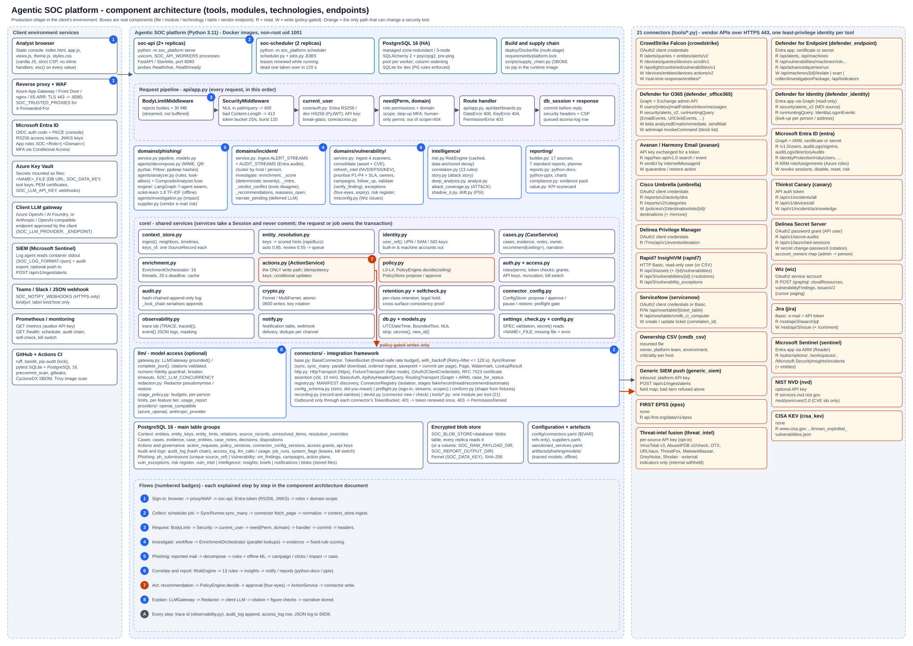

# Component architecture - every tool, module and flow

This document explains `diagrams/platform-component-architecture.svg`, the most detailed view of the platform. Every
box in the diagram is a real component: a container, a Python module, a database table group, a client service or a
vendor API endpoint. The numbered badges (1-8, A) are the flows, walked through step by step in Part 3.

Other views of the same system: `ARCHITECTURE.md` (overview), `ARCHITECTURE_WALKTHROUGH.md` (what to say for the
platform and dev-VM technical diagrams), `ENGINEERING.md` (every design decision and its reason).

---

## Part 1 - How to read the diagram

- **Three zones.**
  - *Left:* services the client already runs, which the platform uses.
  - *Centre:* the platform itself, top to bottom: containers, the request pipeline, the workflow domains and
    intelligence, the shared core services, the model and integration frameworks, then storage.
  - *Right:* the 21 connectors, each with how it signs in and the vendor endpoints it reads (R) or writes (W).
- **Colours.**
  - Blue: platform code.
  - Green: the deployment units.
  - Amber: tool integrations.
  - Orange (`actions.py`, `policy.py` and the orange arrows): the **only** path that can change a security tool.
- **Arrows start at the side that opens the connection.** Almost every connection leaves the platform. Only two kinds
  come in: analysts' browsers, and an optional SIEM push to `POST /api/v1/ingest/alerts`.
- **Names are real.** `core/actions.py`, `jobs.py JOBS` and `/api/v1/...` are the file, object and route names in the
  repository. You can open each one.

---

## Part 2 - Every component

### 2.1 Client environment services (left zone)

| Component | What it is | How the platform uses it |
|---|---|---|
| Analyst browser | The console: `index.html`, `app.js` (shell, router, sign-in, click handling), `views.js` (screens), `theme.js`, `styles.css`. Vanilla JavaScript. | The console has a strict Content Security Policy and no inline handlers. Every value is shown through `esc()`, and every click goes through a `data-fn` attribute checked against an allow-list. |
| Reverse proxy + WAF | The client's Azure App Gateway, Front Door, nginx or IIS ARR. | Terminates TLS on 443 and forwards to port 8080. The app trusts `X-Forwarded-For` only from `SOC_TRUSTED_PROXIES`, and takes the right-most untrusted hop as the client address. |
| Microsoft Entra ID | The client's identity provider. | The console signs in with OIDC authorisation code + PKCE. The API checks RS256 access tokens against Entra's JWKS keys. App roles named `SOC.<Role>[.<Domain>]` become platform roles and domain scope. MFA comes from Conditional Access. |
| Azure Key Vault | The secret store. | Secrets are mounted as files and read through `<NAME>_FILE`: the database URL, `SOC_DATA_KEY` (encryption at rest), tool keys, PEM certificates, `SOC_LLM_API_KEY` and webhooks. A `_FILE` that is missing or empty stops start-up. |
| Client LLM gateway | Azure OpenAI / AI Foundry, Anthropic or an OpenAI-compatible endpoint the client approves. | Optional. It is called only through `llm/gateway.py`, after pseudonymisation. Set with `SOC_LLM_PROVIDER` and `SOC_LLM_ENDPOINT`. |
| SIEM (Microsoft Sentinel) | The client's SIEM. | Two directions. The client's log agent reads the containers' JSON logs (`SOC_LOG_FORMAT=json`) and the audit export. Optionally the SIEM pushes alerts in through `POST /api/v1/ingest/alerts`. |
| Teams / Slack / JSON webhook | Chat or automation endpoints. | `core/notify.py` posts findings above a threshold to them. Only HTTPS endpoints are allowed, set in `SOC_NOTIFY_WEBHOOKS`. The URL is never stored, logged or returned; only `kind:host` is shown. |
| Prometheus / monitoring | The client's monitoring. | Scrapes `GET /metrics` with an auditor API key (`X-API-Key` or `Bearer sk_soc_...`); the alert rules in `deploy/kubernetes/monitoring` watch the scheduler heartbeat, audit chain, failing jobs, unverified actions, break-glass use and sync age. `GET /health` answers "ok" to anyone and the details (scheduler heartbeat, audit chain, kill switch) to a signed-in caller; load balancers and orchestrator probes use `GET /health/live` and `GET /health/ready`. |
| GitHub + Actions CI | Source control and build. | Every change runs these gates: `ruff`, `bandit`, `pip-audit` against the lock, a lock check, `node --check`, `precommit_scan` + gitleaks (secrets and confidential names), pytest on SQLite and on PostgreSQL 16, a CycloneDX SBOM, and a Trivy scan of the image. |

### 2.2 Containers and build (centre, top row)

| Component | Detail |
|---|---|
| `soc-api` container | `python -m soc_platform serve`: uvicorn with `SOC_API_WORKERS` processes running the FastAPI / Starlette app on port 8080. `config check` runs first, and a bad setting stops start-up. Runs as non-root user 1001. |
| `soc-scheduler` container | `python -m soc_platform scheduler`: runs `jobs.py JOBS` in order. Each job run takes a database lease (a row in `system_flags`, renewed while it runs) and is retried up to 3 times; a job that keeps failing is dead-lettered. Two replicas in production: a dead one's job is taken over within the lease (120 s). A heartbeat feeds `/health`. A small deployment can run the scheduler inside `serve` instead. |
| `postgres:16` container | Accessed with SQLAlchemy 2 + psycopg2 (one pool per worker). On start-up the platform adds missing nullable columns and widens VARCHARs. SQLite is used only for development and tests, with PostgreSQL's rules enforced by listeners. |
| Build and supply chain | Multi-stage `deploy/Dockerfile`; `requirements/platform.lock` constrains every package; `scripts/supply_chain.py` writes the SBOM. pip is removed from the runtime image. |

### 2.3 The request pipeline (api/app.py)

Every request passes through these stages in this order. Badge 3 walks through it.

1. **BodyLimitMiddleware** rejects bodies over 30 MB. It counts while streaming, so a large body is never buffered.
2. **SecurityMiddleware** handles three things:
   - a NUL character in the path or query returns 400;
   - a bad `Content-Length` returns 413;
   - a token bucket (20 requests per second, burst 120) returns 429 when exceeded.
3. **current_user** (`core/auth.py`, `core/access.py`) accepts three credentials:
   - an Entra RS256 token (the tenant's v2.0 or v1 issuer; a token without a delegated scope is a service), or a dev
     HS256 token outside production (both must carry `exp` and `iat`);
   - a service-account key, as `X-API-Key` or `Bearer sk_soc_...`;
   - a 15-minute break-glass session token (`Bearer bg....`), issued by `POST /api/v1/auth/break-glass` in exchange
     for the sealed secret, which no other route accepts.

   It checks revocation for each.
4. **need(Perm, domain)** checks that one of the caller's roles grants the permission in that domain:
   - Sensitive operations need step-up MFA.
   - Human-only permissions (approvals, policy, access, rollback) never go to API keys.
   - A record outside the caller's scope answers 404, not 403, so its existence is not revealed.
5. **Route handler** (`api/app.py`, with the read models in `api/dashboards.py`) calls a domain service. Service
   errors map to fixed status codes: `DataError` is 400, `KeyError` is 404, `PermissionError` is 403.
6. **db_session + response**:
   - The transaction is committed **before** the reply is sent, so the next request always sees the write.
   - Security headers and the CSP are added.
   - An access-log row is queued.
   - A write that recorded no specific audit event gets a generic one.

### 2.4 Workflow domains, intelligence and reporting

| Module | Components (functions and files) | What it produces |
|---|---|---|
| `domains/phishing/` | `service.py` (the pipeline), `models.py`, `agents/decompose.py` (MIME parsing, QR codes via pyzbar + Pillow, ppdeep fuzzy hashes), `agents/analyzer.py` (heuristic rules, look-alike domains, `CompositeAnalyzer.fuse`), `engine/` (LangGraph swarm of 7 ML agents, scikit-learn 1.8, TF-IDF content model, offline only), `agents/investigation.py` (who clicked, endpoint and identity impact), `supplier.py` (risk of a supplier's own e-mail). | One case per reported message. Each case has a verdict, campaign scope, who clicked, impact and recommended remediation. |
| `domains/incident/` | `service.py`: ingest of `ALERT_STREAMS` + `AUDIT_STREAMS` (Entra audits), clustering by host or person, `investigate` (parallel enrichment), `_score` (deterministic severity), `_verdict_conflict` (two tools disagree), `_mitre`, `_recommendations`, `reassess_open`, deferred narration through `narrate_pending`. | Incident cases with severity, ATT&CK techniques, evidence and recommended actions. |
| `domains/vulnerability/` | `service.py`: ingest from 4 scanners, `consolidate` (one finding per asset + CVE), `refresh_intel` (NVD, EPSS, KEV), priority P1-P4 with an SLA, owners, campaigns, `follow_up`, validation (`verify_finding`), exceptions (four-eyes, expiry, tool exceptions), risk register; `misconfig.py` (Wiz cloud issues). | Ranked findings, each with an owner, a campaign and a validated fix. |
| `intelligence/` | `risk.py` (`RiskEngine`, cached, decay anchored to the data), `correlation.py` (13 rules), `story.py` (attack story), `deep_analysis.py`, `analyst.py` (Q&A and brief), `attack_coverage.py` (ATT&CK), `shadow_it.py`, `drift.py` (PSI). | Risk per user and host, cross-domain insights, kill-chain stories, coverage and blind spots. |
| `reporting/` | `builder.py` (17 data sources, 7 standard reports, planner), `value.py` (value scorecard: benefit KPIs against baseline and target), `reports.py` (python-docx, python-pptx, charts), `compliance.py` (evidence pack), Jinja2 templates. | Word and PowerPoint reports. Every figure comes from code. |

### 2.5 Core services (core/)

Services take a database session and **never commit**: the request or the job owns the transaction. Two modules are
orange because they form the only write path.

| Module | Responsibility |
|---|---|
| `context_store.py` | `ingest()` stores each normalised record once (`SourceRecord`) and links it to entities. It also provides neighbours, timelines and `keys_of`. |
| `entity_resolution.py` | Strong keys (serial number, object id, SID, UPN) merge first. Weak hints are then scored with rapidfuzz: 0.85 or more merges automatically (with a 0.1 margin over the runner-up); 0.55 or more goes to the review queue. |
| `identity.py` | `user_ref()` turns each tool's way of naming a person into UPN / SAM / SID keys. Built-in and machine accounts are kept apart from people. |
| `cases.py` | `CaseService`: cases, evidence, analyst notes, owner, `recommend(ceiling=)`, deferred narration. |
| `enrichment.py` | `EnrichmentOrchestrator`: parallel lookups (16 threads, 20-second deadline, 30-minute cache). Results are merged in a fixed order. |
| **actions.py** | `ActionService`: the **only** path that writes to a security tool. Each request has an idempotency key; `request` → `approve` / `reject` → execute → `rollback`; status changes are conditional updates. |
| **policy.py** | Autonomy levels L0-L4. `PolicyEngine.decide(ceiling)` applies the caps; `PolicyStore` versions policy changes (propose / approve). |
| `auth.py` + `access.py` | Roles and permissions, token checks, role grants, API keys, revocation, break-glass and the kill switch. |
| `audit.py` | A hash-chained, append-only audit log. `_lock_chain` serialises appends across replicas. |
| `crypto.py` | Fernet / MultiFernet encryption (key rotation); atomic writes with 0600 permissions. |
| `retention.py` + `selfcheck.py` | Retention per data class with legal hold; a proof that every surface shows the same figure. |
| `connector_config.py` | `ConfigStore`: console-managed connector configuration with propose / approve (four-eyes) / pause / restore, gated by preflight. |
| `observability.py` | Trace ids (`TRACE`, `traced()`), structured JSON logs through `event()`, secrets masked. |
| `notify.py` | The `Notification` table and webhook delivery, de-duplicated per channel. |
| `db.py` + `models.py` | `UTCDateTime`, `BoundedText`, NUL stripping, `utcnow()` (the only clock), `new_id()`. |
| `settings_check.py` + `config.py` | Settings from `SOC_*` variables, checked as a whole (`SPEC`). `secret()` reads `<NAME>_FILE`; a missing file is an error. |

### 2.6 Model access (llm/) - optional

| Component | Responsibility |
|---|---|
| `gateway.py` | `LLMGateway.grounded()` / `complete_json()`: - citations checked against the evidence ids supplied; - the numeric-fidelity guardrail drops any figure not in the cited evidence; - a circuit breaker, timeouts, and up to `SOC_LLM_CONCURRENCY` parallel calls. |
| `redaction.py` | `Redactor`: pseudonymises internal names, addresses and hosts before a prompt leaves; restores them in the answer. |
| `usage_policy.py` | Budgets, per-person limits, model tier and answer cap per feature, `usage_report`. A refusal raises `BudgetExceeded`, and the caller falls back to the deterministic text. |
| `providers/` | `openai_compatible` (also used for Azure OpenAI / AI Foundry) and `anthropic_provider`. |

With the model off, every figure, verdict and action is identical: the model writes only narrative.

### 2.7 Integration framework (connectors/)

| Component | Responsibility |
|---|---|
| `base.py` | `BaseConnector`; a thread-safe `TokenBucket` per tool (its rate budget); `with_backoff`, which honours `Retry-After` up to 120 s; `SyncRunner.sync` / `sync_many` (all streams download in parallel and pages are ingested in order, one savepoint and one commit per page); `Page`, `Watermark` and `LookupResult`. |
| `http.py` | `HttpTransport` (httpx) for live calls and `FixtureTransport` for fake mode. Sign-in strategies: OAuth2 client credentials, RFC 7523 certificate assertion (x5t, 10 minutes), Basic, API key header. Also `RoutingTransport` (Graph + ARM) and `raise_for_status`. |
| `registry.py` | Finds `MANIFEST`s; `ConnectorRegistry` isolates a broken connector so the rest keep working, and applies stages (fake / record / read / recommend / automate). |
| `config_schema.py`, `preflight.py`, `conform.py` | Strict configuration checks ("did you mean"); preflight runs every go-live check (sign-in, each stream, write scopes); `conform.py` coerces each record to the stream's shape learned from its fixtures. |
| `recording.py`, `devkit.py` | Record-and-sanitise turns live responses into fixtures. `connector new` / `connector check` scaffold and check a new connector. |
| `tools/*.py` | One module per tool (21). Shared code: `_common.py`, `_microsoft.py` (Graph / OData paging). |

Rules every call follows:
- Outbound calls go only through the connector's `TokenBucket`.
- A 401 renews the token once.
- A 403 becomes `PermissionDenied` and is never retried.

### 2.8 Storage

| Store | Contents |
|---|---|
| PostgreSQL 16 | **Context:** - entities, entity_keys, entity_hints, relations, source_records; - unresolved_items, resolution_overrides. **Cases:** cases, evidence, case_entities, case_notes, decisions, dispositions. **Actions and governance:** action_requests, policy_versions, connector_config_versions, access grants, API keys. **Audit and logs:** - audit_log (hash chain), access_log, llm_calls / usage; - job_runs, system_flags (leases, heartbeats, kill switch). **Domains:** - phishing: ph_submissions (unique `source_ref`); - vulnerability: vm_findings, campaigns, action plans, vuln_exceptions, risk register, vuln_intel; - intelligence: insights, briefs, notifications. |
| Blob store (`core/blobstore.py`) | Reported `.eml` files, generated reports and evidence packs (raw vendor payloads when enabled). `SOC_BLOB_STORE=database`: rows in `blobs`, every replica reads them, covered by the database's HA and backups. `file`: `SOC_RAW_PAYLOAD_DIR` / `SOC_REPORT_OUTPUT_DIR`, files written with 0600 permissions. Encrypted with Fernet (`SOC_DATA_KEY`) either way. |
| Configuration + artefacts | `config/connectors.yaml` (secrets only as `${VAR}` references), `suppliers.yaml`, `sanctioned_services.yaml`, and `artifacts/phishing/models/` (the trained models, used offline). |

### 2.9 The 21 connectors (right zone)

Each tool gets its own least-privilege identity. R means read, W means write. Every W goes only through
`ActionService`.

| Connector | Sign-in | Reads | Writes (policy-gated) |
|---|---|---|---|
| CrowdStrike Falcon | OAuth2 client credentials | alerts (`/alerts/queries` + `entities/alerts/v2`), hosts (`devices-scroll`), Spotlight vulnerabilities | host containment (`devices-actions/v2`), real-time response |
| Defender for Endpoint | Entra app (certificate or secret) | alerts, machines, TVM vulnerabilities, advanced hunting | isolate, scan, collect investigation package, indicators |
| Defender for Office 365 | Graph + Exchange admin API | reported messages, security alerts, hunting (EmailEvents, UrlClickEvents) | remediate analysed e-mails, send message, block list |
| Defender for Identity | Entra app via Graph (read-only) | MDI alerts, IdentityLogonEvents (looked up per person or address) | - |
| Avanan / Harmony Email | API key exchanged for a token | search / event, verdict by Internet Message-Id | quarantine / restore |
| Microsoft Entra ID | Graph + ARM (certificate or secret) | users, sign-ins, directory audits, risky users, Azure role assignments | revoke sessions, disable / enable account, reset password, confirm compromised |
| Cisco Umbrella | OAuth2 client credentials | DNS activity, categories | destination lists (add / remove) |
| Thinkst Canary | API auth token | incidents, devices | acknowledge incident |
| Delinea Privilege Manager | OAuth2 client credentials | elevation events | - |
| Delinea Secret Server | OAuth2 password grant (API user) | secret audits, launched sessions, account owners (admin → person) | change password (rotation) |
| Rapid7 InsightVM | HTTP Basic, read-only user (or CSV) | assets, vulnerabilities (+ solutions), vulnerability exceptions | - |
| Wiz | OAuth2 service account | `POST /graphql`: cloud resources, vulnerability findings, issues (cursor paging) | - |
| ServiceNow | OAuth2 client credentials or Basic | ticket table, CMDB CI computers | create / update ticket (by correlation id) |
| Jira | E-mail + API token | search (JQL) | create issue, comment |
| Ownership CSV | Mounted file | owner, platform team, environment, criticality per host | - |
| Microsoft Sentinel | Entra app via ARM (Reader) | SecurityInsights incidents (+ entities) | - |
| Generic SIEM push | Inbound, platform API key | `POST /api/v1/ingest/alerts` with a field map; one bad item is refused on its own | - |
| NIST NVD | Optional API key | `/rest/json/cves/2.0` (sends CVE ids only) | - |
| FIRST EPSS | None | `api.first.org/data/v1/epss` | - |
| CISA KEV | None | `known_exploited_vulnerabilities.json` | - |
| Threat-intel fusion | Per-source API key (opt-in) | VirusTotal v3, AbuseIPDB, OTX, URLhaus, ThreatFox, MalwareBazaar, GreyNoise, Shodan | - (internal addresses and the organisation's own domains are never sent) |

Every connector also has **fake mode**: vendor-shaped fixtures run through the same parsing code, so the whole
platform runs with no tenant access.

---

## Part 3 - The complete flows, step by step

### Flow 1 - Sign-in

1. The analyst opens the console URL. The reverse proxy / WAF terminates TLS and forwards to `soc-api` on port 8080.
2. `GET /api/v1/auth/config` tells the console which identity provider to use. The console signs the analyst in with
   Entra ID (authorisation code + PKCE); MFA is enforced by Conditional Access.
3. Every API call carries the access token. `current_user` checks the following, and any failure answers 401:
   - the RS256 signature against Entra's JWKS keys;
   - audience, issuer, `exp` and `iat`;
   - revocation (`core/access.py`).
4. App roles become platform roles, each with a domain scope:
   - `SOC.Lead` gives the lead role in every domain;
   - `SOC.Analyst.Phishing` gives the analyst role in phishing only.

   From then on, visibility is the union of the caller's roles. What the caller may *do* in a domain is decided by the
   role that applies there.
5. `POST /api/v1/auth/logout` revokes the token at once.

### Flow 2 - Collect (scheduler → tools → context store)

1. The scheduler finds the jobs that are due from the database (the last `job_runs`) and runs them in `JOBS` order:
   - vulnerability (6 h), incident (5 min), phishing (2 min);
   - follow-up and daily report (daily), weekly reports (weekly);
   - intelligence (10 min), retention (daily), self-check (hourly; also stores the audit checkpoint and logs the
     chain's head as `audit.anchor`), notify (1 min), actions (1 min: approved actions still waiting; executions
     stuck past 15 minutes marked `unverified`).

   Vulnerability runs first, so incidents are never scored without exposure data.
2. Each job takes a lease in `system_flags` (a compare-and-swap), re-checks that the job is still due, runs, records
   the run, then releases the lease. The lease is renewed while the job runs, so two replicas never run the same job,
   and a job whose scheduler died is taken over one lease (120 s) later. Inside the phishing and incident jobs each
   item runs in its own savepoint, so one that fails never holds up the others.
3. `SyncRunner.sync_many` downloads all of a tool's streams **in parallel**. Each request:
   - goes through the tool's `TokenBucket`, so the tool's rate budget is never exceeded;
   - backs off on 429;
   - renews the token on a 401;
   - stops on a 403 (`PermissionDenied`).
4. Each page is normalised to a `NormalizedRecord` (`core/schema.py`):
   - entities with strong `keys` and weak `hints`;
   - events with `refs`.

   Missing or wrongly typed fields are tolerated (`conform.py`, `parse_ts`). A record without its identifier is
   refused on its own, and the rest of the page still loads.
5. Pages are ingested **in order** through `context_store.ingest()`. `entity_resolution` links each record to one host
   or one person; uncertain matches go to the review queue. Each page commits in its own savepoint.
6. On the last page the resume point is saved: a watermark for event streams, or `None` for inventories, which are
   re-read in full. A crash resumes from the last committed page. Re-running changes nothing.

### Flow 3 - The request pipeline

This is the path every API call takes. Each stage is described in section 2.3; in brief:

1. Body limit.
2. NUL / Content-Length checks and rate limit.
3. Identity.
4. Permission + domain scope.
5. Handler.
6. Commit, then reply with security headers.

The access-log row and audit event carry the request's trace id (flow A).

### Flow 4 - Investigate an incident

1. The incident job ingests EDR, identity, deception, PAM and SIEM alerts (`ALERT_STREAMS`) and Entra audits
   (`AUDIT_STREAMS`), then clusters related alerts by host or person into one case.
2. `investigate` hands the case's entities to the `EnrichmentOrchestrator`:
   - it looks them up in every enabled tool **in parallel** (16 threads, 20-second deadline, 30-minute cache);
   - results are merged in a fixed order;
   - database work stays on the job's thread.
3. Evidence rows are written (idempotently).
4. `_score` computes severity and confidence with fixed rules over the evidence signals. It starts from the alert's own
   severity, then:
   - a deception hit sets it to critical;
   - KEV exposure on the host raises it one step;
   - three or more corroborating dimensions (endpoint, identity, DNS, deception, threat intel, privileged access,
     exposure) raise it to at least high;
   - confidence grows with the number of dimensions, capped at 0.95.

   `_verdict_conflict` flags tools that disagree.
5. `_mitre` maps the evidence to ATT&CK techniques. `_recommendations` proposes actions, which go through flow 7 and
   by default stay recommended.
6. The job commits the cases, then calls `narrate_pending`. The model, if enabled, writes the explanation in
   parallel (flow 8). Until then the case shows the deterministic explanation.
7. When new KEV exposure appears, `reassess_open` rescores open incidents, without duplicating evidence.

### Flow 5 - Phishing

1. A user reports an e-mail. The phishing job collects reports from Defender for Office 365 or Avanan
   (`ingest_reported`); an analyst can also upload one (`POST /api/v1/phishing/submit`).
   - There is one case per reported message (unique `source_ref`).
   - The raw `.eml` is stored encrypted.
2. `agents/decompose.py` parses the message:
   - headers and authentication results;
   - the sender and look-alike domains;
   - URLs, QR codes, attachments (with fuzzy hashes) and body text.

   Parsing is bounded, so hostile content costs linear time. URLs from the e-mail are **never fetched**.
3. `agents/analyzer.py` applies the heuristic rules. If installed, the offline ML engine (`engine/`, a LangGraph swarm
   of 7 agents, one trained model per component) scores the same message. `CompositeAnalyzer.fuse` combines the two
   into a verdict and confidence: malicious, suspicious, spam or safe.
4. Three things run alongside each other:
   - **campaign scope:** who else received the same message, from the mail tools;
   - **reconciliation** with the other e-mail control;
   - **impact**, from `agents/investigation.py`: who clicked (Umbrella, URL clicks), whether a click reached the site,
     identity compromise (Entra risk and sign-ins), and endpoint impact (EDR alerts on the clicker's host).
5. Severity follows from the verdict and the impact. A malicious message that someone clicked is raised.
   Recommendations follow: quarantine every copy, block the sender and domains, revoke sessions, reset passwords,
   isolate an affected host. All go through flow 7.
6. Safe, low-risk cases can be closed automatically. A stable-hash QA sample is kept for review. An analyst
   confirmation (`confirm`) feeds confirmed indicators back into detection.

### Flow 6 - Correlate, notify and report

1. The intelligence job runs `RiskEngine` and computes an explainable risk per user and host, made of factors:
   phishing, incidents, exposure, identity risk and privilege. Risk decays with time measured from the latest data,
   not the wall clock. Open exposures and incidents never decay.
2. `correlation.py` runs the 13 rules.
   - Per entity:
     - phishing chain;
     - consent after phishing;
     - privileged account after compromise;
     - deception corroborated;
     - exposed host under attack;
     - attacked host without EDR;
     - entity risk high.
   - Across the estate:
     - repeat clickers;
     - control gaps;
     - new KEV exposure;
     - shared infrastructure;
     - supplier risk;
     - drift.

   Each finding has evidence, severity, next steps and a `dedupe_key`, so re-runs update it instead of duplicating it.
3. `story.py` rebuilds the cross-tool kill chain for a case (the attack story). A fingerprint over the evidence lets
   an approved story be recognised again.
4. The notify job sends findings above the threshold to Teams, Slack or a webhook, once per (finding, severity,
   channel).
5. Reports: `reporting/builder.py` takes figures from its 17 data sources. `reports.py` writes Word or PowerPoint
   (7 standard reports, daily and weekly jobs, or built on demand with `POST /api/v1/reports/build`). Generated files
   are encrypted and downloaded through `/api/v1/reports/{rid}/download`.

### Flow 7 - Act: the policy-gated write path (orange)

1. A domain recommends an action. Examples: isolate a host (CrowdStrike / MDE), quarantine an e-mail (MDO / Avanan),
   revoke sessions (Entra), add a destination-list block (Umbrella), rotate a secret (Delinea), open a ticket
   (ServiceNow / Jira).
2. `ActionService.request` builds an idempotency key: the type plus a SHA-256 of the type, parameters, targets and
   case. The same request twice is one action. It then checks the action's preconditions.
3. `PolicyEngine.decide` starts from the configured level (default **L2 = recommend**) and lowers it:
   - a failed precondition, or more targets than the hard limit: **blocked**;
   - the kill switch: capped at L3;
   - the tool's rollout stage: `read` allows no actions, `recommend` caps at L2;
   - a destructive action type: never autonomous (L3);
   - a VIP or critical target: approval required;
   - more targets than the maximum: lead approval required;
   - four-eyes: two different people must approve.

   Every reason is shown to the analyst.
4. The outcome is one of: observed (L0-L1), **recommended** (L2), pending approval (L3), or execute (L4, only where
   the policy explicitly allows it).
5. The approvals list (`GET /api/v1/actions`) says what each action was raised on (its case, or a remediation
   ticket's campaign); `GET /api/v1/actions/{id}/context` gives the reviewer the evidence it cites (numbered by
   `evidence_for_llm`, as on the case), the tool and its impact. An action is visible when its domain is, and its
   case too when it has one; a campaign ticket's `case_id` is the campaign's id, so the domain alone decides.
   A person approves (`POST /api/v1/actions/{id}/approve`) or rejects:
   - Approval needs a human with step-up MFA, never an API key or an agent.
   - Approval counts only for roles whose scope covers the action's domain.
   - An analyst who requests an action they may approve is approving it, unless four-eyes applies; then a different
     person must approve, because the requester cannot approve their own action.
   - A four-eyes action an agent recommended needs two different people: the first approval is recorded
     (`action.first_approval`, status stays `pending_approval`, `awaiting_second_approval`) and the second, by
     someone else, executes it. Both are conditional updates, so two people approving at once cannot both be first.
6. On approval, `ActionService` re-judges the decision in the action's own domain, moves the status to `executing`
   with a conditional update (exactly once), **commits it with its audit record**, and only then calls the
   connector's write method, with no transaction open; the outcome and its audit record are committed after. An
   action approved inside a job's per-item savepoint waits as `approved` and runs right after the job commits.
   Domains and the API never call the write method directly.
7. Reversible actions can be rolled back (`/rollback`): that requests the reverse action (for example release from
   containment or restore an e-mail) through the same policy, four-eyes included; the original is marked
   `rolled_back` when the reverse executes.
8. Every step is in the audit log.
9. The kill switch stops autonomous execution only. To stop every write to a tool, pause the tool in the console.

### Flow 8 - Explain (optional model)

1. A feature needs narrative: the case explanation, deep analysis, an answer to an analyst's question, the situation
   brief, or report text. It passes computed facts to `LLMGateway`, each with an evidence id.
2. `usage_policy.py` checks the budget, the person's limits and the feature's switch and tier. A refusal raises
   `BudgetExceeded`, and the feature uses its deterministic text.
3. `Redactor` replaces internal names, addresses, `DOMAIN\\user` accounts, host names under the organisation's
   domains, the case's own device names and internal IP addresses with pseudonyms - one map per call. The prompt goes
   only to an approved (https, in production) endpoint: the client's own LLM gateway.
4. The answer is untrusted input:
   - it is parsed with `model_list` / `model_choice` / `model_ids`;
   - each claim must cite evidence ids that were supplied;
   - uncited claims are dropped;
   - any figure not in the cited evidence is dropped (numeric-fidelity guardrail).
5. Pseudonyms are restored. The narrative is stored next to, never instead of, the computed verdict and figures.
   Model calls are logged with tokens and cost (`llm_calls`).

### Flow A - On every step: trace and audit

- Each request, job run and CLI command gets a **trace id** (`observability.TRACE`), and every outbound call, model
  call, audit event and log line carries it. One id ties an analyst's click to the vendor call it caused.
- **Audit:** `audit_log` is append-only and hash-chained. Each event includes the previous event's hash, so a
  changed or deleted row breaks the chain. The self-check re-hashes it hourly, stores where it reached, and logs
  the head (`audit.anchor`) for the log platform; `/health` re-hashes only newer records. The database refuses
  UPDATE / DELETE / TRUNCATE on it (trigger), and the runtime role holds INSERT / SELECT only. Every successful write
  request is audited.
- **Access log:** one row per request (who, route, status, time), without query strings or bodies.
- **Logs:** structured JSON on stdout through `event()`, with secrets masked. The client's SIEM collects them.

---

## Part 4 - Where each security property is enforced

| Property | Enforced by |
|---|---|
| Only authenticated, in-scope callers | `current_user` + `need(Perm, domain)`; out-of-scope records answer 404 |
| Nothing changes a tool without approval by default | `ActionService` is the only write path; `PolicyEngine.decide` default L2; stage ceilings; four-eyes |
| The model never decides | Figures and verdicts come from code; the gateway drops uncited claims and figures not in the evidence; identical behaviour with the model off |
| Internal identities do not leave | `Redactor` pseudonymisation; threat-intel lookups withhold internal addresses and own domains; NVD gets CVE ids only |
| No secrets in code or configuration | Key Vault files (`<NAME>_FILE`); `${VAR}` references only; pre-commit scan and gitleaks in CI |
| Tamper evidence | Hash-chained `audit_log`, checked by `/health` and the self-check; append-only trigger and grants; heads anchored in the log platform |
| Data at rest | Fernet on raw payloads and reports (unsealed data refused in prod); PostgreSQL storage encryption from the client's platform |
| Data in transit | TLS at the gateway (1.2+); `sslmode=verify-full` to PostgreSQL (required in prod); connector credentials only to the connector's own origin |
| Least privilege in the database | The platform runs as a role without schema rights; only `init-db` holds the owner's credentials |
| One tool's failure does not stop the rest | Registry isolation; jobs, screens and reports degrade to "unavailable" and keep last known values |
| Supply chain | Locked dependencies, SBOM, pip-audit, Trivy, non-root image without pip |
