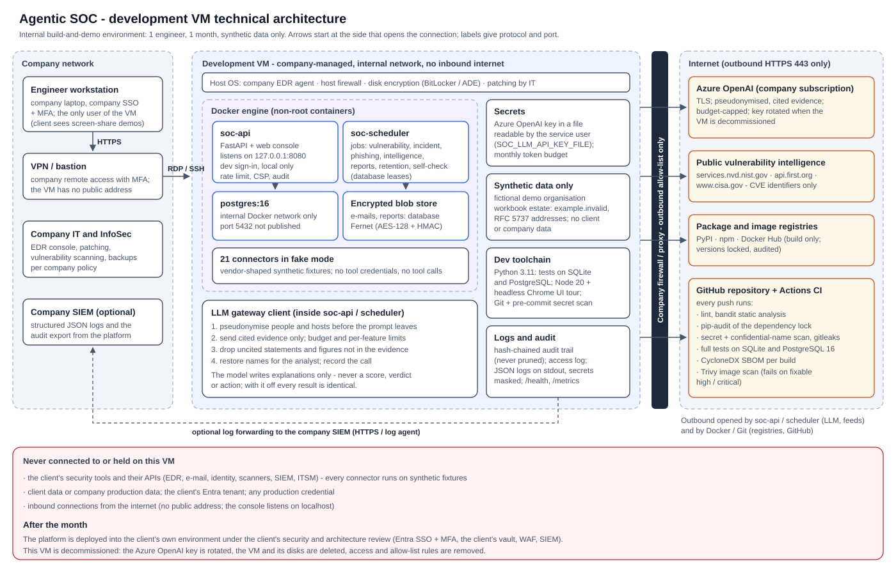

# Development VM - setup, security and decommissioning

How the internal development and demonstration VM is set up and run. It is used by one engineer for the one-month
build, holds synthetic data only and is decommissioned when the platform moves to the client's environment (the
client deployment follows [CLIENT_DEPLOYMENT_GUIDE.md](CLIENT_DEPLOYMENT_GUIDE.md)).

## 1. What the VM is for, and what it never holds

| | |
|---|---|
| Purpose | develop the platform, run its test suites (SQLite and PostgreSQL), run it with synthetic data, demonstrate it by screen-share |
| Users | one (the project lead); no client logins |
| Data | synthetic only: the fake-mode fixtures (fictional Acme organisation) and the data handoff workbook's estate (`example.invalid`, documentation addresses) |
| Never on it | client or company data, production tool credentials, any live connection to a security tool |
| Lifetime | one month, then decommissioned (section 6) |

## 2. Size and software

Suggested size (estimate, confirm with IT): 4 vCPU, 16 GB RAM, 100 GB disk, Windows or Linux - the full test suite
on SQLite and PostgreSQL in parallel is the heaviest load. Software: Git, Python 3.11, Docker (platform containers,
PostgreSQL 16), Node.js 20 with Chrome or Edge (the automated browser tour).

## 3. Network

- **No inbound access from the internet.** `python -m soc_platform serve` listens on `127.0.0.1` unless `SOC_HOST` is
  changed; leave it, and open the console on the VM itself (or over the company VPN / bastion).
- **Outbound HTTPS only, to an allow-list:**

| Destination | Why |
|---|---|
| the Azure OpenAI / AI Foundry endpoint of the subscription | AI-written explanations (pseudonymised evidence only) |
| `services.nvd.nist.gov`, `api.first.org`, `www.cisa.gov` | public vulnerability intelligence (CVE identifiers only) |
| `pypi.org`, `files.pythonhosted.org`, `registry.npmjs.org`, `github.com` | packages and source control |
| `registry-1.docker.io`, `auth.docker.io`, `production.cloudflare.docker.com` | container images |

- Company EDR agent and host firewall stay on, as on any company machine. Disk encryption (BitLocker / Azure Disk
  Encryption) covers the database files.

## 4. Secrets

The only secret on the VM is the Azure OpenAI key.

1. Put it in a file, not in the environment and never in the repository:
   - Windows: `notepad C:\soc\secrets\llm_key` then
     `icacls C:\soc\secrets\llm_key /inheritance:r /grant:r "%USERNAME%:R"`
   - Linux: `install -m 600 /dev/null /etc/soc/llm_key` and write the key into it
2. Point the platform at it: `SOC_LLM_API_KEY_FILE=C:\soc\secrets\llm_key` (any `SOC_*` secret accepts the `_FILE`
   form). `python -m soc_platform config check` reports an error if the file is missing or empty.
3. Cap spend: `SOC_LLM_MONTHLY_TOKEN_BUDGET` (and per-person limits on the AI usage screen); the platform refuses model
   calls beyond the budget and falls back to its deterministic explanations.
4. Block accidental commits: `python scripts/precommit_scan.py --install` (pre-commit hook: no `.env` secret value
   and no confidential name - the pattern lives in `.git/info/banned-names`, outside the repository - can be committed).
5. Sign-in on this VM is development mode (`SOC_ENVIRONMENT=dev`, `SOC_DEV_JWT_SECRET` set, console on localhost
   only). Production sign-in (Entra ID with MFA) is configured in the client's environment.

## 5. Every change is checked

Locally before a commit (CLAUDE.md section 9) and again in CI (`.github/workflows/ci.yml`) on every push: lint,
static security analysis (bandit), dependency audit of the lock (`requirements/platform.lock`), lock consistency, the
full test suite on SQLite and on PostgreSQL, a secret and confidential-name scan, gitleaks over the history, a CycloneDX
SBOM (`scripts/supply_chain.py sbom`, kept as a build artefact) and a container image scan (Trivy, fails on fixable
high / critical findings).

## 6. Decommissioning (end of the month)

1. Revoke / rotate the Azure OpenAI key in the Azure portal (it was on the VM).
2. Confirm everything needed is in source control (`git status` clean, pushed).
3. Delete the VM and its disks (nothing on it needs to be kept: synthetic data only).
4. Remove the VM's outbound allow-list rules and the user's access.
