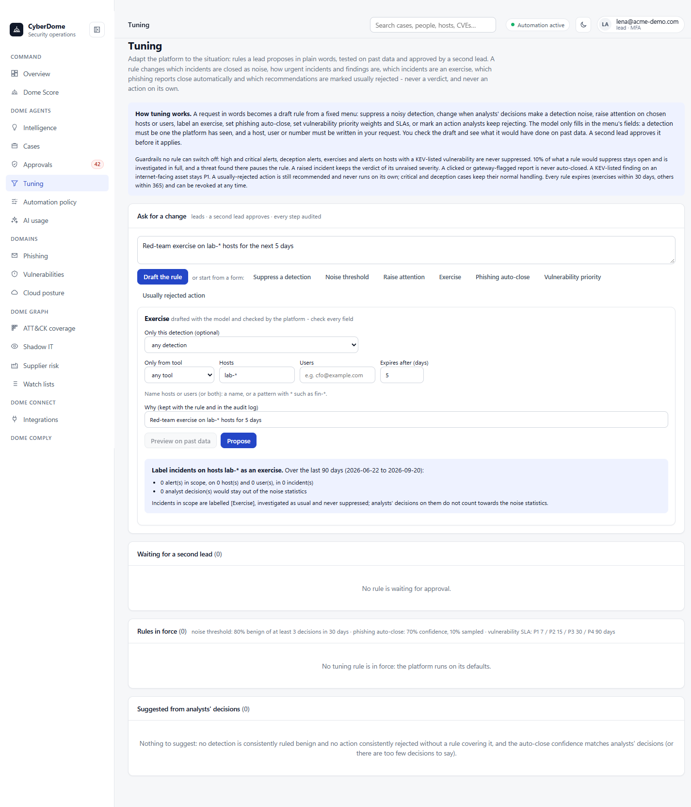
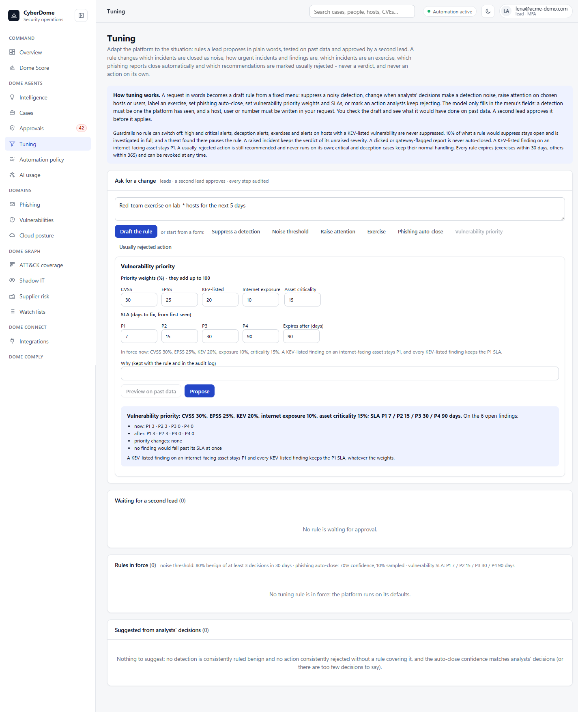

# Tuning - user guide

Tuning lets a SOC lead adapt CyberDome to the situation in plain words. Nothing applies until a **second lead**
approves it. A lead can:

- cut noise from a detection;
- raise attention on chosen hosts or people;
- label a red-team exercise;
- change phishing auto-close;
- reweight vulnerability priorities and SLAs;
- mark an action analysts keep rejecting.

Everything here is computed in code and implemented in `soc_platform/core/tuning.py`. The console screen is
**Dome Agents -> Tuning**.

Contents:

1. [What tuning is](#1-what-tuning-is)
2. [Who can do what](#2-who-can-do-what)
3. [The Tuning screen at a glance](#3-the-tuning-screen-at-a-glance)
4. [Step by step: create a rule](#4-step-by-step-create-a-rule)
5. [Reading the preview](#5-reading-the-preview)
6. [Approve, reject, revoke](#6-approve-reject-revoke)
7. [The seven rule types](#7-the-seven-rule-types)
8. [Guardrails that always hold](#8-guardrails-that-always-hold)
9. [Suggestions from analysts' decisions](#9-suggestions-from-analysts-decisions)
10. [After a rule is live](#10-after-a-rule-is-live)
11. [Writing good requests](#11-writing-good-requests)
12. [Troubleshooting and FAQ](#12-troubleshooting-and-faq)
13. [API reference](#13-api-reference)
14. [Quick reference](#14-quick-reference)

---

## 1. What tuning is

Every change follows the same path:

1. You describe the change in words, or fill in a form.
2. The platform turns it into a **draft rule from a fixed menu** of seven rule types and checks every field against
   the data it holds.
3. You see what the rule **would have done over the last 90 days**, counted from stored alerts and analysts'
   decisions.
4. You propose it with a reason. A **second lead** approves it, and only then does it apply.
5. The rule expires on its own. Any lead can revoke it at once.

```
request in words ──► draft ──► edit + preview ──► propose ──► second lead ──► active
                                                                  │             │
                                                                  └─► rejected  ├─► revoked    (any lead, at once)
                                                                                ├─► paused     (an analyst found a threat in what it suppressed)
                                                                                ├─► superseded (a newer rule of a one-at-a-time type)
                                                                                └─► expired    (by date)
```

Three promises hold for every rule:

- **The model never decides.** When the AI model helps, it only fills in the menu's fields from your words. A
  detection it names must be one the platform has seen. A host, user or number must be written in your request.
- **A rule never changes a verdict and never runs an action.** A rule can change only these things:
  - which incidents close as noise;
  - how urgent incidents and findings are;
  - which incidents are an exercise;
  - which phishing reports close automatically;
  - which recommendations are labelled usually rejected.
- **Guardrails always hold.** Some alerts are never suppressed, whatever a rule says: high and critical alerts,
  deception alerts, exercises, and alerts on hosts with a KEV-listed vulnerability ([section 8](#8-guardrails-that-always-hold)).

This guide is for:

- SOC leads, who propose and approve rules;
- analysts, who want to know why a case was closed, raised or labelled.

## 2. Who can do what

Only leads can propose, approve, reject or revoke rules, and only in the domains their role covers. Everyone who can
see a domain can read its rules.

| Role | Read rules | Draft, preview, propose | Approve, reject | Revoke |
|---|---|---|---|---|
| Lead | Yes, in their domains | Yes, in their domains | Yes, but never a rule they proposed | Yes, in their domains |
| Analyst | Yes, in their domains | No | No | No |
| Automation admin, admin, auditor, CISO | Yes, in their domains | No | No | No |
| API key or agent | - | Never | Never | Never |

- **The permission.** It is `tune_detections`, and only the Lead role has it.
  - It is human-only: it is never granted to an API key, whatever roles the key holds.
  - It needs a fresh MFA sign-in (step-up).
- **Domain scope.** Each rule type belongs to one domain, and you need `tune_detections` in that domain:
  - *incident*: suppress a detection, noise threshold, raise attention, exercise;
  - *phishing*: phishing auto-close;
  - *vulnerability*: vulnerability priority;
  - *the domain the rule names*: usually rejected action.

  So a phishing lead cannot suppress an incident detection. The screen shows only the forms you may use.
- **Separation of duties.** The lead who proposes a rule can never approve it.
  - Names are compared without regard to case.
  - On your own proposal, the screen shows "A second lead approves" in place of the buttons.
- **Stopping needs one person.** Any lead in the rule's domain can revoke an active rule alone, with immediate effect.

A lead without incident scope sees no alert titles or tools in the forms. None are sent to the model when they draft.

## 3. The Tuning screen at a glance



The screen has six cards, from top to bottom. Analysts, and anyone else without `tune_detections`, do not see
**Ask for a change**.

| Card | What it shows | What you can do |
|---|---|---|
| **How tuning works** | A short explanation, the guardrails no rule can switch off, the QA share and the expiry limits in force | Read it |
| **Ask for a change** (leads only) | A text box for the request, **Draft the rule**, and one button per rule type you may use, to start from an empty form | Draft from words or from a form, edit, preview, propose |
| **Waiting for a second lead** | Each proposed rule: a summary in one sentence, the reason, the original request, who proposed it and when, and what it would have done | **Approve** or **Reject** (not on your own proposals) |
| **Rules in force** | Each active rule: who approved it and when, what it has done since (e.g. "12 suppressed · 1 kept open for QA"), and when it expires. Under the title: the noise threshold, the phishing auto-close settings and the vulnerability SLAs in force | **Revoke** |
| **Suggested from analysts' decisions** | Ready drafts: noisy detections, actions analysts keep rejecting, a phishing auto-close confidence | **Draft a rule**, which opens the filled-in form |
| **History** | Rejected, revoked, paused, superseded and expired rules, each with a status chip, who decided, when, and the note | Read it |

Each rule's line says how it was drafted:

- **"drafted with the model, checked by the platform"**: the AI filled in the form.
- **No label**: a lead filled in the form, or the platform read the request without the model.

## 4. Step by step: create a rule

**Step 1. Describe the change.** In **Ask for a change**, type what you want in one or two sentences (up to 1,500
characters), then click **Draft the rule**. For example:

- "Stop raising incidents for the scanner's port scans on scan-* hosts"
- "Finance servers fin-* matter more until quarter close, for 30 days"
- "Red-team exercise on fin-* hosts for the next 5 days"

If you already know the rule type, click its button (for example **Raise attention**) to start from an empty form.

**Step 2. Read who drafted it and the notes.** The form opens with the rule type at the top and one of two labels:

- *drafted with the model and checked by the platform*: the AI read your words;
- *drafted by the platform from your words*: the model was off, refused or over its budget, so the platform read the
  request with its own patterns.

A yellow box lists anything the platform corrected, for example:

- "the host pattern was dropped: it is not written in the request"
- "benign_percent 85 is not written in the request - the default 80 is used"
- "no detection the platform has seen is named in the request - choose it from the list"
- "the model did not answer this request (refused or unavailable) - the platform read it itself"

If your words describe a rule type your role cannot propose, the platform says so and opens no form.

**Step 3. Check and edit every field.** The fields depend on the rule type ([section 7](#7-the-seven-rule-types)):

- Detections and tools are drop-down lists of what the platform has actually seen, with alert counts.
- Hosts and users take a name, or a pattern with `*` or `?`. Examples: `fin-*`, `scan-??`, `*@acme-demo.com`.
- Numbers have their allowed range built in.

Set **Expires after (days)**. Write **Why**: it is required, and it is kept with the rule and in the audit log.

**Step 4. Preview on past data.** Click **Preview on past data**. A box shows what the rule would have done
([section 5](#5-reading-the-preview)). It turns **red** when the rule would have done harm:

- hidden something an analyst ruled a threat;
- put findings past their SLA at once;
- labelled an action analysts approved.

Narrow the rule and preview again until the result is what you meant.

**Step 5. Propose.** Click **Propose**.

1. The platform recomputes the preview and asks you to confirm with a one-line summary, such as "8 of 9 matching
   alerts in the last 90 days would have been suppressed".
2. After you confirm, the rule appears under **Waiting for a second lead**. The preview is kept with it, so the
   approver sees the figures you saw.

Drafting and previewing change nothing. A draft is only noted in the audit log (`tuning.drafted`).

## 5. Reading the preview

The preview counts from stored records and analysts' decisions; the model writes none of it. A red box means stop
and narrow the rule.

For incident rules, the 90-day window ends at the **newest alert**, not at today, so a quiet week does not empty
the preview.

| Rule type | What the preview shows | Warning (red box) |
|---|---|---|
| Suppress a detection | Matching alerts and how many would be suppressed, by severity and number of hosts. How many the guardrails would keep, and why ("host carries a KEV-listed vulnerability", "medium severity is above the rule's cap (low)", "deception alert"). The incidents those alerts were part of, by analyst verdict. Up to 10 example alerts. The QA share | *N of them were ruled a threat by an analyst*: the rule would have hidden real incidents |
| Noise threshold | The detections that would **become** noise and those that would **stop** being noise, each with its number of decisions and benign share | None, but read the "would become noise" list |
| Raise attention | Alerts, hosts, users and incidents in scope; how severities would move (e.g. "3 medium -> high") | None. "No severity would change" means nothing is in scope yet, or it is already critical |
| Exercise | Alerts, hosts, users and incidents in scope; how many analyst decisions would stay out of the noise statistics | None |
| Phishing auto-close | Out of the reports analysed so far: how many would auto-close compared with now, about how many would be sampled for QA, and the platform's suggested confidence | *N of them were ruled a threat by an analyst*: raise the confidence |
| Vulnerability priority | Open findings per band (P1-P4) now and after, the priority changes, example findings | *N finding(s) would be past SLA at once*: their owners would get no notice |
| Usually rejected action | Over 90 days, how analysts decided this action in this scope: rejected, approved, not decided yet, or kept because the case was critical or deception | *Analysts approved N of these*: narrow the rule or do not propose it |

## 6. Approve, reject, revoke

**Approving (the second lead).** The second lead's job is to check that the rule does what its reason says, and
nothing more.

1. Read the summary sentence, the reason and the original request under **Waiting for a second lead**.
2. Read **What it would have done**, the preview saved with the proposal. Be wary of any threats hidden, findings past
   SLA, or actions analysts approved.
3. Click **Approve**. The dialog repeats the rule and its preview. Add an optional note and confirm.

What happens on approval:

- The platform checks the rule's settings again, because the data may have changed since it was proposed.
- The rule applies **at once**, and its expiry date is set from the approval time.
- A rule of a one-at-a-time type (noise threshold, phishing auto-close, vulnerability priority) **supersedes** the
  one in force.
- A vulnerability priority rule reprioritises every open finding immediately.
- The audit log records `tuning.activated` with the proposer, the approver, the expiry and the note.

**Rejecting.** Click **Reject** and say why. The rule moves to History as *rejected* (`tuning.rejected`). To try
again, propose a corrected rule.

**Revoking.** Under **Rules in force**, click **Revoke** and say why (required).

- It takes effect at once and needs no second lead (`tuning.revoked`).
- A revoked vulnerability priority rule restores the defaults and reprioritises immediately.
- Revoking does **not** reopen incidents the rule already closed. Find them by the rule number in their summary
  ([section 10](#10-after-a-rule-is-live)).

## 7. The seven rule types

### 7.1 Suppress a detection

**Use it when** one detection keeps producing incidents analysts close as benign, often on a known source such as a
vulnerability scanner or a backup server.

**What it does:** a new incident is **closed as noise** (`suppressed_noise`) when two conditions hold:

- the rule covers **every** alert in it;
- no guardrail keeps any of those alerts.

The case summary says "Suppressed by tuning rule #N (approved by ...)" followed by the rule in words.

| Setting | Meaning | Allowed |
|---|---|---|
| Detection (required) | The alert title, chosen from titles the platform has seen | Seen titles only |
| Only from tool | Narrow to one tool | Tools seen in alerts |
| Only on hosts | Host name or pattern | `fin-*`, `scan-??` (letters, digits, `. - _ @`, not only wildcards) |
| Only for users | User name, e-mail or pattern | Same as hosts |
| Up to severity | Highest severity it may suppress | informational, low (default), medium |
| Expires after | Days | 1-365, default 90 |

> Example request: *"Stop raising incidents for 'Port scan from vulnerability scanner' on scan-* hosts, low severity, for 60 days."*

One in ten incidents the rule would suppress stays open as a **QA sample** and is investigated in full. If an
analyst rules a suppressed or sampled case malicious or suspicious, the rule **pauses at once**.

### 7.2 Noise threshold

**Use it when** the platform's automatic noise detection is too eager or too slow.

Without any rule, a detection counts as **noise** when at least 80% of at least 3 analyst decisions on it in 30 days
were benign. A new low or medium incident made entirely of noisy detections closes as noise automatically. Its
summary reads "Auto-suppressed: detection consistently dispositioned benign". This rule changes those three numbers.

| Setting | Default | Allowed |
|---|---|---|
| Benign share (%) | 80 | 60-100 |
| At least (decisions) | 3 | 2-50 |
| Over (days) | 30 | 7-180 |
| Expires after | 90 | 1-365 |

Only one noise threshold is in force at a time. When it expires or is revoked, the defaults return. High and critical
incidents never close as noise.

> Example request: *"Only call a detection noise when 90% of at least 10 decisions in 60 days were benign."*

### 7.3 Raise attention

**Use it when** some hosts or people matter more for a while: finance servers at quarter close, executives during a
targeted campaign, a server just exposed to the internet.

**What it does:** new and re-assessed incidents that involve a matching host or user count **1 or 2 severity
levels higher**, up to critical. The case's severity factors show "raised by tuning rule" with from, to, why and who
approved it.

| Setting | Meaning | Allowed |
|---|---|---|
| Hosts and/or users (one required) | Name or pattern | As above |
| Only this detection | Optional narrowing | Seen titles |
| Only from tool | Optional narrowing | Seen tools |
| Raise by | Levels | 1 (default) or 2 |
| Expires after | Days | 1-365, default 90 |

Three things do **not** change:

- the verdict, which is still judged on the unraised severity;
- the approval level of any action;
- the other rules: only one raise applies to an incident, so boosts never stack.

> Example request: *"Finance servers fin-* matter more until quarter close, raise by one level for 30 days."*

### 7.4 Exercise

**Use it when** a red team, purple team or penetration test is running.

**What it does:** incidents that involve the matching hosts or users get the title prefix **[Exercise]**. They are:

- investigated as usual;
- **never suppressed** (the team is testing whether they are seen);
- kept out of the noise statistics, so the test does not teach the platform that the activity is noise.

| Setting | Meaning | Allowed |
|---|---|---|
| Hosts and/or users (one required) | Name or pattern | As above |
| Only this detection / tool | Optional narrowing | Seen titles and tools |
| Expires after | Days | 1-**30**, default **7** |

> Example request: *"Red-team exercise on fin-* hosts for the next 5 days."*

### 7.5 Phishing auto-close

**Use it when** analysts spend time on reported e-mails that are clearly safe or spam, or when auto-close has
closed something it should not have.

**What it does:** sets the confidence at which reports the platform judges **safe** or **spam** close on their own.
It also sets the share of those that is kept for QA review.

| Setting | Default | Allowed |
|---|---|---|
| Auto-close at confidence (%) | 70 | 50-95 |
| Sample for QA (%) | 10 | 5-50 |
| Expires after | 90 | 1-365 |

A report that somebody clicked, or one a mail gateway rated worse, is **never** auto-closed. Only one auto-close rule
is in force at a time.

> Example request: *"Auto-close safe phishing reports at 85% confidence and sample 20% for QA."*

### 7.6 Vulnerability priority

**Use it when** the organisation weighs risk differently, for example exploitation likelihood over raw CVSS. Also
use it when remediation SLAs must change.

| Setting | Default | Allowed |
|---|---|---|
| CVSS weight (%) | 30 | 0-60 |
| EPSS weight (%) | 25 | 0-60 |
| KEV-listed weight (%) | 20 | 0-60 |
| Internet exposure weight (%) | 10 | 0-60 |
| Asset criticality weight (%) | 15 | 0-60 |
| SLA P1 / P2 / P3 / P4 (days) | 7 / 15 / 30 / 90 | 1-30 / 1-60 / 1-180 / 1-365 |
| Expires after | 90 | 1-365 |

The five weights must add up to **100**. SLA days must not shrink from P1 to P4.

Two rules hold whatever the weights:

- A KEV-listed finding on an internet-facing asset stays **P1**.
- Every KEV-listed finding keeps the P1 SLA.

The rule applies to every open finding **at once** on approval.



> Example request: *"Vulnerability priority: EPSS 35%, CVSS 20%, KEV 20%, exposure 10%, criticality 15%; P1 5 days."*

### 7.7 Usually rejected action

**Use it when** analysts keep rejecting the same recommendation in the same context, for example isolating build
servers for a detection that is routine there.

**What it does:** new recommendations of that action in scope are still made and shown, but:

- they are labelled **"usually rejected here (tuning rule #N): recommend only"**;
- they are capped at L2 (recommend), so they can **never run autonomously** there;
- critical and deception cases are never affected.

| Setting | Meaning | Allowed |
|---|---|---|
| Domain (required) | incident, phishing or vulnerability | Domains you lead |
| Action (required) | Action type, e.g. `endpoint.isolate` | Actions the platform has recommended |
| Only for this detection | Optional; incident actions only | Seen titles |
| Only on hosts / for users | Optional patterns | As above |
| Expires after | Days | 1-365, default 90 |

> Example request: *"Analysts keep rejecting endpoint.isolate on build-* hosts - stop recommending it there."*

## 8. Guardrails that always hold

No rule can switch these off. They are enforced in code at the moment a rule applies, not only in the preview.

| Guardrail | Effect |
|---|---|
| High and critical alerts are never suppressed | A suppression rule's cap is medium at most. Noise closes only low and medium incidents |
| Deception alerts are never suppressed | Canary (deception) alerts always open an incident, and it is critical |
| Exercises are never suppressed | An incident labelled [Exercise] stays open whatever suppression applies |
| Hosts with a KEV-listed vulnerability | Their alerts are never suppressed |
| 1 in 10 suppressions stays open | A QA sample, chosen by a stable hash of the alert ids (a re-run makes the same choice), investigated in full |
| A threat found pauses the rule | An analyst ruling a suppressed or sampled case malicious or suspicious pauses the suppression rule at once (`tuning.paused`) |
| A raise never changes a verdict | The verdict is judged on the unraised severity; actions keep their approval level |
| No stacked boosts | Only one raise-attention rule applies to an incident |
| Phishing | A clicked or gateway-flagged report is never auto-closed |
| Vulnerability | A KEV-listed finding on an internet-facing asset stays P1; every KEV-listed finding keeps the P1 SLA |
| Usually rejected actions | Still recommended, never autonomous; critical and deception cases keep normal handling |
| Everything expires | At most 365 days (exercises 30). Any lead can revoke at once |
| Two people, both human | Proposer and approver differ; never an API key or an agent; step-up MFA |
| Everything is audited | `tuning.drafted`, `tuning.proposed`, `tuning.activated`, `tuning.rejected`, `tuning.revoked`, `tuning.paused` |

## 9. Suggestions from analysts' decisions

The **Suggested from analysts' decisions** card offers ready drafts, computed from analysts' decisions; the model
plays no part. Each still needs a proposal and a second lead.

| Suggestion | When it appears | The draft |
|---|---|---|
| Suppress a detection | Analysts' decisions make the detection noise under the threshold in force, and no active suppression covers it | Suppress that detection up to low severity, for 90 days |
| Usually rejected action | At least 5 human decisions on one action in one context (domain, action, detection) in the 30 days up to the newest decision, at least 80% rejected, and no rule covers it | Mark that action usually rejected in that context, for 90 days |
| Phishing auto-close confidence | At least 10 reports with an analyst's ruling, and a different confidence would do better | The lowest confidence (in steps of 5%) at which no report analysts ruled a threat would have closed |

Click **Draft a rule** to open the filled-in form. Then preview and propose as usual. You can narrow the draft first,
for example by adding a host pattern.

## 10. After a rule is live

**Where you see a rule's effect**

| Rule | Where it shows |
|---|---|
| Suppress a detection | The incident is closed with verdict *suppressed_noise*. Its summary reads "Suppressed by tuning rule #N (approved by ...): ...". **Rules in force** counts "N suppressed · N kept open for QA" |
| Noise threshold | Incidents closed as noise say "Auto-suppressed: detection consistently dispositioned benign"; the threshold in force is shown under **Rules in force** |
| Raise attention | The case severity is higher, and its severity factors show *raised by tuning rule* (from, to, why, approved by). The rule counts "N incident(s) raised" |
| Exercise | The case title starts with **[Exercise]**; the rule counts "N incident(s) labelled" |
| Phishing auto-close | Applies to every new report; the settings in force are shown under **Rules in force** |
| Vulnerability priority | Every open finding's priority and SLA due date. The SLAs in force are shown under **Rules in force** |
| Usually rejected action | The recommendation's reason reads "usually rejected here (tuning rule #N): recommend only"; the rule counts "N recommendation(s) labelled" |

**Scope in time.** Rules act on **new** incidents and reports. Raise attention also applies when an open incident is
re-assessed, and vulnerability priority applies to every open finding at once. Approving a suppression does not close
incidents that already exist. Revoking one does not reopen the incidents it closed.

**QA samples.** A sampled incident looks like any other open incident, but the rule's count marks it "kept open for
QA". Investigate it fully and record a verdict. A benign verdict confirms the rule; a malicious or suspicious one
pauses it.

**A paused rule** moves to History with the note "paused: case ... was ruled malicious" (or suspicious). It cannot be
resumed. Investigate the case, then propose a narrower rule if one is still needed.

**Expiry.** A rule stops applying at its expiry date and shows as *expired* in History. A one-at-a-time rule returns
to the defaults when it expires. To extend a rule, propose a new one before the old one expires.

## 11. Writing good requests

- **Name the detection as it appears.** Copy the alert title from a case or from the drop-down list. The platform
  only accepts titles it has seen.
- **Write the hosts and users yourself.** Patterns like `scan-*`, `fin-*` or `*@acme-demo.com` must appear in your
  words. The model may add a wildcard, but it may not invent a name.
- **Write the numbers yourself.** "for 30 days", "85%", "at least 10 decisions", "raise by 2 levels", "P1 5 days".
  Any number not in your request is replaced by the default, with a note.
- **Use the words that pick the rule type** (the platform's own reading, when the model is off, keys on them):

| You want | Words that work |
|---|---|
| Exercise | exercise, red team, pen test, penetration test, purple team |
| Phishing auto-close | auto-close, phishing |
| Noise threshold | threshold, benign share, decisions |
| Vulnerability priority | vulnerability, SLA, CVSS, EPSS, patch |
| Usually rejected action | keeps rejecting, stop recommending, don't recommend |
| Raise attention | raise, higher, more important, matters more, escalate, prioritise, watch ... closely |
| Suppress a detection | anything else that names a detection |

- **Narrow first, widen later.** Start with a tool, a host pattern and a low severity cap. Widen only if the preview
  and the QA samples stay clean.
- **Give a real reason.** "Scanner noise on scan-* hosts, confirmed with the infrastructure team" helps the approver
  and the auditor. "noise" does not.
- **Keep exercises short.** Match the test window. The maximum is 30 days.

## 12. Troubleshooting and FAQ

**Messages when you propose or preview**

| Message | Fix |
|---|---|
| name the detection (alert title) to suppress | Choose a detection from the list |
| no alert titled '...' has been seen - choose one from the list | The title is not known; pick it from the drop-down |
| no alert from tool '...' has been seen | Choose a tool from the list, or leave "any tool" |
| host / user must be a name or a pattern with * or ? (letters, digits, . - _ @), not only wildcards | Use e.g. `fin-*`; `*` alone is refused |
| name the hosts or users it covers (a name or a pattern such as fin-*) | Raise attention and exercise need a host or a user |
| max_severity must be one of informational, low, medium - high and critical are never suppressed | Pick a lower cap |
| levels must be 1 or 2 | Raise by 1 or 2 levels |
| expires_days must be a whole number of days from 1 to 365 (30 for an exercise) | Shorten the expiry |
| ... must be a whole number from X to Y | Bring the number into its range ([section 14](#14-quick-reference)) |
| the five weights must add up to 100 (they add up to N) | Adjust the vulnerability weights |
| SLA days must not shrink from P1 to P4 | Make each band's days at least the band above's |
| name an action the platform has recommended | Pick the action from the list |
| a detection narrows incident actions only | Clear the detection for phishing or vulnerability actions |
| say why the rule is needed | Fill in **Why** |

**Messages when you decide**

| Message | Meaning |
|---|---|
| separation of duties: a second lead approves - not the one who proposed it | Ask another lead |
| rule N is active / rejected / ... - it cannot be approved | Someone already decided it; refresh the screen |
| say why the rule is revoked | A reason is required to revoke |
| a lead with ... scope (tune_detections) changes this tuning - a person, never an API key | Your role or domain does not cover this rule type |

**FAQ**

- *I can't see "Ask for a change".* You need the Lead role, a fresh MFA sign-in, and scope in the rule's domain.
- *The draft came back as the wrong rule type.* Change the request's wording ([section 11](#11-writing-good-requests)),
  or start from the right form's button.
- *The draft says the model did not answer.* The model was off, over its budget or refused. The platform read the
  request with its own patterns. Check every field; the rule works the same either way.
- *An incident I expected to be suppressed is open.* Check four things:
  - Is it a QA sample?
  - Does a guardrail keep it: severity above the cap, a deception alert, or a KEV-listed host?
  - Does it contain an alert the rule does not cover?
  - Is it labelled [Exercise]?
- *The rule shows "paused".* An analyst ruled one of its suppressed or sampled cases a threat. Read that case before
  proposing again.
- *Can I edit an active rule?* No. Propose a new rule, then revoke the old one once the new one is approved. A
  one-at-a-time rule type replaces the old one automatically.
- *Does the model see my data?* Only when it drafts. It then sees your request and the lists of detection titles,
  tools and action types, pseudonymised by the gateway like any model call. Previews and the rules themselves never
  involve the model.

## 13. API reference

All routes need a signed-in person with `tune_detections` in the rule's domain, except `GET`, which needs read
access. Write routes need step-up MFA.

| Method and path | Body | Returns |
|---|---|---|
| `GET /api/v1/tuning` | - | Rules in your domains, the settings in force, suggestions, the rule types you may propose, known detections / tools / actions, bounds and defaults |
| `POST /api/v1/tuning/draft` | `{"request": "<3-1500 chars>"}` | `{kind, params, reason, drafted_by, notes, request}`; nothing stored |
| `POST /api/v1/tuning/preview` | `{"kind": "...", "params": {...}}` | The preview ([section 5](#5-reading-the-preview)); nothing stored |
| `POST /api/v1/tuning` | `{"kind", "params", "reason", "request_text"?, "drafted_by"?}` | The proposed rule (preview computed and saved) |
| `POST /api/v1/tuning/{id}/approve` | `{"note": "..."}` (optional) | The active rule |
| `POST /api/v1/tuning/{id}/reject` | `{"note": "..."}` | The rejected rule |
| `POST /api/v1/tuning/{id}/revoke` | `{"note": "<required>"}` | The revoked rule |

Errors:

- `403`: no right in the rule's domain, or separation of duties.
- `404`: unknown rule or decision.
- `409`: the rule is not in a state that allows the decision.
- `422`: invalid settings; the message names every problem.

Example:

```json
POST /api/v1/tuning
{"kind": "suppress_detection",
 "params": {"detection": "Port scan from vulnerability scanner", "host": "scan-*", "max_severity": "low", "expires_days": 60},
 "reason": "Scheduled scanner on scan-* hosts; confirmed with infrastructure"}
```

## 14. Quick reference

| Item | Value |
|---|---|
| Preview window | 90 days, ending at the newest alert |
| QA sample of suppressions | 10% (stable hash) |
| Default expiry / maximum | 90 / 365 days |
| Exercise default / maximum | 7 / 30 days |
| Suppression severity cap | informational, low (default), medium |
| Noise threshold default (bounds) | 80% benign (60-100) of at least 3 decisions (2-50) in 30 days (7-180) |
| Phishing auto-close default (bounds) | 70% confidence (50-95), 10% sampled (5-50) |
| Vulnerability weights default | CVSS 30, EPSS 25, KEV 20, exposure 10, criticality 15 (each 0-60, sum 100) |
| Vulnerability SLA default (bounds) | P1 7 (1-30), P2 15 (1-60), P3 30 (1-180), P4 90 (1-365) days |
| Usually rejected suggestion | at least 5 human decisions, at least 80% rejected, 30 days |
| Auto-close suggestion | at least 10 analyst-ruled reports, steps of 5% |
| One at a time (superseded by a newer one) | noise threshold, phishing auto-close, vulnerability priority |
| Who | Lead role, `tune_detections` in the rule's domain, step-up MFA, a person; proposer is not the approver |

| Status | Meaning |
|---|---|
| proposed | Waiting for a second lead |
| active | In force until its expiry |
| rejected | Turned down by a lead |
| revoked | Stopped by a lead |
| paused | Stopped because an analyst found a threat in what it suppressed |
| superseded | Replaced by a newer rule of a one-at-a-time type |
| expired | Past its expiry date |
