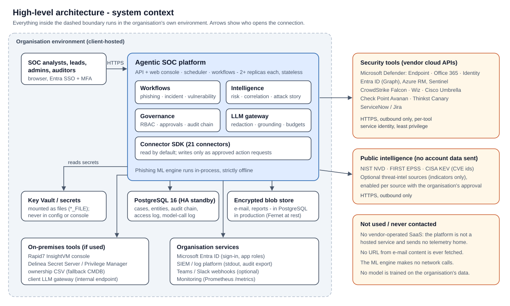
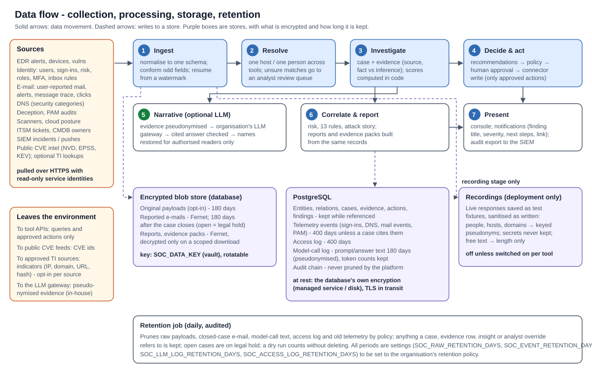
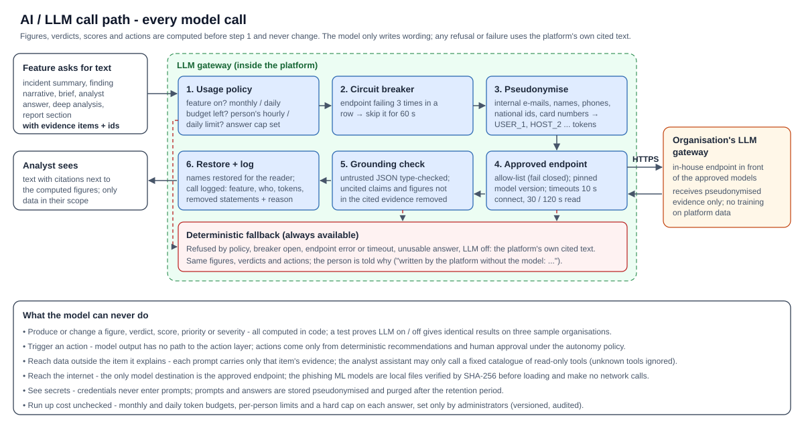
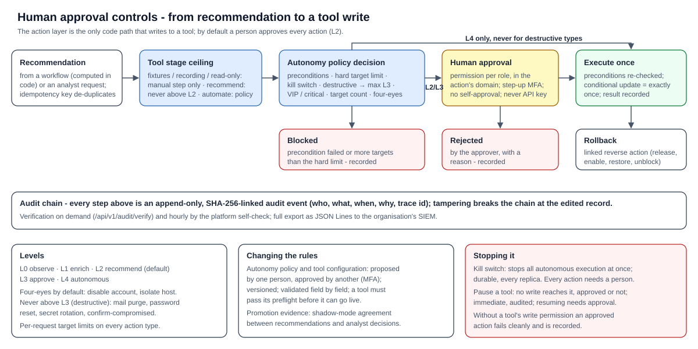

# Architecture and data flow overview

| | |
|---|---|
| **Document** | Architecture and data flow overview - Agentic SOC platform |
| **Version** | 1.0 - 2026-10-13 |
| **Audience** | Customer presentation: security leadership, architecture, SOC |

## About the platform

The Agentic SOC platform is a planned investigation and automation layer that runs inside the organisation's own
environment, on top of the security tools it already owns. It recommends actions; **a person approves them**. An
optional AI model, reached only through the organisation's own LLM gateway, writes explanations from evidence but
never makes a decision.

**Status:** the design below is **Planned**. The development environment (a dedicated development VM) is being set up.

## 1 High-level architecture

| Part | Planned role |
|---|---|
| SOC analysts | Use a browser; sign in with the organisation's Entra ID single sign-on and MFA; roles decide what each person sees and may approve |
| Platform | Runs in the organisation's environment: workflows (phishing, incident, vulnerability), intelligence (risk, correlation), governance (roles, approvals, audit), LLM gateway client, connectors |
| Security tools | Reached through their vendor APIs over HTTPS, outbound only, with a dedicated least-privilege identity per tool; read-only by default |
| Organisation services | Entra ID, the vault holding credentials, the SIEM / log platform, monitoring, optional Teams / Slack notifications, the organisation's LLM gateway |
| Storage | PostgreSQL and an encrypted file store, both inside the organisation's environment |

## 2 Data flow

1. **Collect** - connectors read alerts, inventory, findings, sign-ins and reported e-mails from the tools.
2. **Link** - each record is resolved to one host or one person; ambiguous matches go to an analyst.
3. **Investigate** - the workflows enrich, score with fixed rules and recommend actions.
4. **Decide** - an analyst reviews the evidence and approves or rejects each action.
5. **Act** - approved actions are sent to the tool through one governed action layer; every step is audited.

## 3 AI / LLM components

- Optional, and reached only through the organisation's own LLM gateway.
- Names of people and hosts are pseudonymised before a prompt leaves the platform and restored after.
- The model writes explanations from evidence it is given and must cite it; uncited statements and figures not in
  the evidence are removed.
- The model never produces a figure, verdict, score or decision, and cannot trigger an action. With the model off,
  every result is the same.

## 4 Analyst interaction and control

- Default policy: **recommend** - every action waits for a person's approval.
- High-impact actions need two people; irreversible actions can never run on their own.
- A kill switch stops all automatic execution; pausing a tool stops every write to it.

## 5 External data transfers

| Destination | What is sent | When |
|---|---|---|
| The organisation's security tools (vendor cloud APIs) | API requests for data; approved actions | Always, per connected tool |
| Public vulnerability intelligence (NVD, EPSS, CISA KEV) | CVE identifiers only | When enabled |
| Threat-intelligence sources | Indicators only (hashes, external domains / IPs); internal addresses and the organisation's own domains are never sent | Only sources the organisation approves |
| The organisation's LLM gateway | Pseudonymised evidence for explanations | Only if the AI is enabled |
| Anything else | Nothing: no vendor-hosted service, no telemetry home, no URL from an e-mail is ever fetched | - |

The detailed versions are in *Solution architecture*, *Data flow and protection* and *AI / LLM security*.
